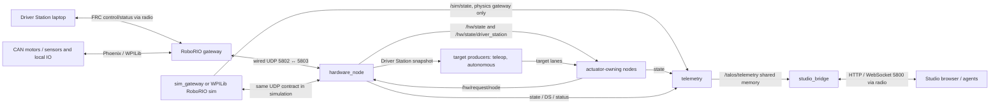

# Robot data flow and byte budgets

This is the wire/slot contract, not the native `sizeof(State)` or a claim about
Ethernet airtime. Bytes below exclude UDP/IP/Ethernet overhead unless explicitly
included. Changes to a frame, codec, device cap, slot, or telemetry budget must
update this document and its matching compile-time assert in the same change
([hard rule](../RULES.md)). Fully populated encoder tests pin the State,
Command, and Driver Station formulas to the actual encoders. A number here
that follows a hidden HTML comment `size: <name>` is checked:
`//tools:check_data_flow_sizes_test` fails unless it equals what
`//tools:data_flow_sizes` prints for that name from the defining headers,
and unless every printed size is marked somewhere (a new one gets its marker
in the same change). Those markers cover the protocol version, UDP frame, payload-codec,
device-cap, shared-memory slot, framework message slot and byte
(`pose_observation`, `pose_estimate`, `odometry_sample`), live-registry,
dispatch-log, and telemetry-page/burst constants defined in framework headers;
numbers in inline code spans, bench and example config arithmetic and
bench/example message sizes, measured telemetry and wake-socket tables, and
Studio bridge egress budgets are intentionally unchecked.

## Processes and links

For processor ownership and layer boundaries, see
[Architecture: Two processors](../ARCHITECTURE.md#two-processors). A robot's
own nodes that own no actuator (cameras, a pose estimator) read and publish
shared-memory topics only; its repository documents their rates.

### Link rates and endpoints

| Link / direction | Transport / port | Trigger or rate in the bench configuration |
|---|---|---|
| Devices ↔ RIO backend | CAN / local DIO, analog, encoder, PWM; no IP port | Gateway samples/applies on `Config.period_us`: 5000 µs = 200 Hz. Phoenix motion feedback requests `status_hz`; voltage/stator-current/supply-current/fault diagnostics request `min(status_hz, 50)` Hz; device temperature requests `min(status_hz, 4)` Hz. A motor another motor follows also requests its duty cycle, and both its voltage and duty cycle at 20 Hz or more, the slowest a Phoenix follower's leader output may run. Shared vendor frames apply their highest requested rate: under the vendor library's simulation, where every signal but the fault field shares one frame, voltage/current/temperature remain 200 Hz with 200 Hz feedback and the fault field applies 50 Hz; the rates a physical bus applies have not been measured. Disabled one-shot neutral refresh remains every hardware tick. |
| Driver Station ↔ RIO | WPILib/FRC native control/status over radio; not talOS UDP | DS produces new data at 50 Hz. The RIO program's `talos-ds` thread refreshes WPILib's cache on each new DS packet, or 20000 µs after the last without one, snapshots it whole and reports the program's mode while the hardware loop ticks; the loop observes the mode generation each hardware tick from the latest snapshot, and sends that snapshot as the DriverStation packet, as no Driver Station (no mode, no joystick input) once its refresh is `command_timeout_us` old ([hardware README](../talOS/hardware/README.md#roborio)); snapshot cadence is in row DriverStation (24). Native FRC packet layouts are external to this repo. |
| RIO → hardware_node: State (type 20) | UDP source gateway 5802 → bridge 5803, wired robot switch | One snapshot per gateway tick, 200 Hz; echoes clock probe send time only after a subsequent gateway tick. |
| hardware_node → RIO: Command (21) | UDP 5803 → 5802 | The bridge sleeps until a gateway datagram, a `/hw/request/<node>` publication or its next time-driven duty, and merges each request when it is published, within a CPU budget of 8 passes and 64 received datagrams per 1000 µs window (`HardwareNode::kDatagramBudget`), past which it sleeps through input to the window's end (`HardwareNode::kCpuWindowUs`); one pass receives at most 32 (`HardwareNode::kReceiveBudget`). While the latest State says the gateway can take a command (configured and commissioned, enabled, no fault), send immediately when the merged command changes, its observation included, so one command per accepted request that changes the merge; actuator nodes publish on their own `period_us`, each request carrying a new observation or demand, so in `robot.toml` at most motor 200 + swerve_module 200 = 400 commands/s, each a 138 B frame (3 motors: 98 B payload) ≈ 55 kB/s (in `robot_py.toml`, whose Python motor runs at 20000 µs, 50 + 200 = 250/s ≈ 34.5 kB/s). Otherwise heartbeat `clamp(command_timeout_us / 5, 5000, 20000)` µs: 20000 µs = 50 Hz with the configured 100000 µs timeout. While the latest State says it cannot (disabled, unconfigured, uncommissioned or faulted), a change of the observation alone waits for that heartbeat, so the bridge sends exactly one command per heartbeat (50/s × 138 B ≈ 6.9 kB/s) plus one at once per change of a demand, output or identity word, whatever the owners' periods and phases (`HardwareNode::CommandDueUs`). Only after observed state and while a subsystem request is active. The RIO receives at most 64 frames per 5000 µs hardware tick and applies only the highest-sequence command of each tick's batch (`endpoint.h` `kReceiveBudget`), about 2 commands per tick at 400/s, so a backlog queued during a RIO stall is skipped, not replayed. |
| hardware_node → RIO: Config chunks (22) | UDP 5803 → 5802 | Whole config push on observed boot/config mismatch or while unacknowledged; retry on State after ≥50000 µs, doubling after rejected ACKs from 100 ms to 2 s. A changed boot ID pushes immediately and resets backoff. Commands continue during backoff; no pushes after successful matching acknowledgment. |
| RIO → hardware_node: ConfigAck (23) | UDP 5802 → 5803 | On completed assembly and asynchronous reconfiguration, or rejected chunk/config; no per-chunk ACK for incomplete assemblies. An assembly completed while a configure is pending (every boot restore) gets no ACK; the bridge's ≥50000 µs retry pushes again. Per-device degraded configure succeeds, with invalid samples identifying unavailable devices. An ACK whose send fails is sent again at the start of each later gateway tick until a send succeeds or a newer transfer completes: its ACK replaces the old one, and one whose configure is pending drops it, so only the newest completed transfer's ACK goes out. |
| RIO → hardware_node: DriverStation (24) | UDP 5802 → 5803 | 50 Hz on real RIO and standalone `sim_gateway`, independently of the hardware tick: snapshots are ≥20000 µs apart, except that the tick observing a new mode sends one at once. An enabled mode switch (autonomous to teleop) changes no State; only the new generation retires the old mode's target lanes. |
| hardware_node → RIO: ClockProbe (25) | UDP 5803 → 5802 | Empty payload; bridge send time in frame header. At most 50 Hz, one outstanding, replaced after 100 ms unanswered (a lost probe or echo), well inside the 1 s exchange lifetime; independent of enable, commissioning and active requests. |
| hardware_node → device-owning nodes / DS consumers / telemetry | Shared-memory `/hw/state`, `/hw/state/driver_station`, `/hw/status`; no port | State/DS when their frame arrives; bridge status first tick then every 20000 µs (50 Hz, `node.h`'s `kStatusPeriodUs`). Consumers run at their own periods. |
| actuator-owning nodes (`motor`, `swerve_module`) → hardware_node | Shared-memory `/hw/request/<node>` | Devices-layer flush each update, on the node's `period_us`: 5000 µs (200 Hz) for both (20000 µs for the Python motor of `robot_py.toml`). A node that owns only inputs (`gyro`) publishes no request. Bridge neutralizes an owner silent past its [owner timeout](../ARCHITECTURE.md#the-tick) (50 ms for each of these). |
| target producers (`teleop`) → actuator nodes | Shared-memory target lanes | On the producer's `period_us`, `teleop`'s 5000 µs (200 Hz); mode/freshness policy selects one lane. |
| `sim_gateway --physics` → simulated sensors (a robot's simulated cameras) / telemetry | Shared-memory `/sim/state` | Every physics/hardware tick (200 Hz); main-processor node-clock timestamp, true field pose and field-frame velocity. No writer under ideal or WPILib/RoboRIO simulation. |
| Any publisher → the loop of a reader asleep on its topic (wake) | AF_UNIX datagram, Linux abstract address / macOS `/tmp/talos-wake-<id>`; no port ([talOS/rtms](../talOS/rtms/README.md#wake-channel)) | 1 byte, at most one per reader sleep per topic: a write sends one to each reader slot armed since the last publication (a reader of a prompt subscription under `Delivery::ON_PUBLISH`, the bridge's reader of each `/hw/request/<node>`, or `studio_bridge`'s reader of `/talos/telemetry`, between its drain and its next block), none when no reader is armed; a writer taking over a topic sends one to every reader with a receiver. A lost datagram costs a node's loop up to its 1 s backstop, the bridge up to its longest wait, 10000 µs (`HardwareNode::kMaxWaitUs`), and `studio_bridge` up to its next duty, at most its 250 ms graph refresh ([Studio bridge](../studio/bridge/README.md#waking)). A send that fails other than to a gone receiver counts in the writer's registry row (`wake_failures`), and a request the bridge's latest-value read passes over in its subsystem's request row (`requests_skipped`; [wake loss](../talOS/introspection/README.md#wake-loss)). |
| Nodes → telemetry → studio_bridge | Shared-memory states/statuses → `/talos/telemetry` byte topic | Telemetry period 10000 µs = 100 Hz, each tick as one or more value pages; dictionary pages before the first tick and every 100th (1 Hz at this rate). |
| studio_bridge ↔ browser/agent | HTTP + WebSocket, configured port 5800 | Per client: graph, dictionary pages and a keyframe on connection, then change-only telemetry updates of at most one per producer tick and system-graph value updates of at most one per 500 ms (the whole graph again when its structure changes), deferred and coalesced when the egress budget is short. HTTP requests are not the value stream. |
| studio_bridge → driver dashboard (`/drive`) | WebSocket, the same port | Per drive client (at most the layout's `drive_clients`, outside `max_clients`): dictionary pages and a keyframe of the feed's channels (the layout's, `hw/status/alert_error_link_lost`, and with an `alerts` widget every alert channel) on connection, then change-only updates of those channels at most `update_hz` (default 20) a second, an empty update after 100 ms without one, and the drive summary (at most <!-- size: telemetry.drive_summary_bytes -->4,096 B) on change at most every 500 ms; within the layout's `budget_bytes_per_s` (default 24,000 B/s), reserved out of the bridge's 160,000 B/s ([bridge README](../studio/bridge/README.md#driver-dashboard-feed)). |

A failed send never kills the bridge (`RuntimeUdpPeer` raises no
`SIGPIPE`). When a send or receive on the gateway socket fails with an error its
socket never recovers from (`protocol::SendErrorNeedsNewSocket` /
`protocol::ReceiveErrorNeedsNewSocket`, whose errors per OS are in
[talOS/protocol](../talOS/protocol/README.md): a socket shut down or marked
defunct, an invalid descriptor, or one whose source address left the host), the
bridge removes the descriptor from its poller, closes the socket and opens a new
one on the same addresses and ports (`Reopen()`, which keeps the frame sequence
the gateway's replay gate checks): on its next pass, at most 1000 µs later, then
at most every 100000 µs (`HardwareNode::kReopenRetryUs`). When `[robot]
local_address` (or `--local-address IP`) pins a specific local IPv4 address that
is not yet on the host at startup (`EADDRNOTAVAIL` / `ENETUNREACH`), the bridge
starts with the socket closed and retries opening it on that same 100000 µs
cadence without falling back to `0.0.0.0`. While it is closed nothing is sent or
received, so the RoboRIO neutralizes at its command timeout and `/hw/status`
`state_age_us` grows, as for an unplugged cable; with no route to the
RoboRIO at all, each new socket's open fails and is retried on that
cadence. Any other send or receive error (`ECONNREFUSED` while the RoboRIO
program is down, for one) keeps the socket, and a failed send's duty is retried
1000 µs later. The bridge prints the errno once per
outage and one line when a send succeeds again; its exit line counts
`send_failures` and `socket_reopens`. The RoboRIO program replaces its own
socket by the same rules (`protocol::SendErrorNeedsNewSocket` and
`protocol::ReceiveErrorNeedsNewSocket`), on its 100 ms open-retry cadence
([talOS/hardware](../talOS/hardware/README.md#roborio)).

Camera observation timestamps describe exposure, not publication. Measure
timestamp bias during [camera bring-up](BRINGUP.md#camera-intrinsics-calibration).
`talOS/vision/frame.h`'s `CaptureMidpoint` maps a frame's stamp to the
exposure midpoint: the per-kind exposure/readout correction, then the
camera's measured stamp bias, `latency_offset_ns`, subtracted from every
kind (step 6 of [camera calibration](BRINGUP.md#camera-intrinsics-calibration));
it gives no stamp on overflow or underflow.

Timing sources: `bench/main_processor/configuration/robot.toml`, its
`subsystems/*.toml`, `talOS/bridge/node.cc` (`Tick`, `PushConfig`,
`CommandDueUs`), `talOS/hardware/endpoint.h` (`Endpoint::Tick`),
`controller_processor/rio/src/main/cpp/Robot.cpp`
(`Robot::StartCompetition`), and
`talOS/simulation/sim_gateway.cc`.

Phoenix 26.3.0 `CoreTalonFX.hpp` / `SpnValue.hpp` identify stator current,
supply current and device temperature as `PRO_SupplyAndTemp` SPNs 1779–1783.
[CTRE's shared-frame rule](https://v6.docs.ctr-electronics.com/en/stable/docs/api-reference/api-usage/status-signals.html)
applies the highest requested rate to a shared frame. The Phoenix desktop
rate test checks the effective rates: the current and temperature reads share
a frame already requested at 200 Hz, adding no requested status-frame traffic.
This is not a measured
whole-bus utilization percentage: use each `/hw/status` `can_buses` slot's
utilization (one per configured bus, the RoboRIO's and each CANivore's)
during physical bring-up, including all other devices and control traffic.
Temperature older than 500 ms and supply current older than 50 ms read as zero
without invalidating motion feedback, like existing effort diagnostics.
Standalone ideal/physics simulation reports ambient 25 °C and placeholder
supply current proportional to voltage effort; Phoenix desktop uses its SDK
electrical-current model and ambient 25 °C. None is a thermal model or an
automatic thermal derating policy. Raw `/hw/state` stays in local logs and
has no reflected radio channels; only the bench motor state adds these scalars.

## UDP frame and payload sizes

One datagram contains exactly one protocol frame, version <!-- size: protocol.version -->**11**.
The explicit little-endian header is <!-- size: frame.header_bytes -->**40 B**: magic u64 (8),
version/header_size/type/flags u16 (8 total),
sequence u64 (8), monotonic_time_us u64 (8), payload_size u32 (4), reserved u32
(4). Payload maximum is <!-- size: frame.max_payload_bytes -->**1432 B**; frame maximum <!-- size: frame.max_bytes -->**1472 B** = 1500-byte MTU −
20-byte IPv4 header − 8-byte UDP header. Under this IPv4/MTU contract talOS frames
need no IP fragmentation (`talOS/protocol/frame.h`, `frame.cc`, `types.h`).

A change to any payload codec's bytes, or to
what it accepts (State, Command, config, ConfigAck, Driver Station), bumps
`kProtocolVersion`, even when every length stays. Sessions keep the payload
bytes, and every reader of recorded hardware packets decodes them only under
the version the session recorded (REQ-OPS-51): the bridge's own, on every
`/hw/status` (`protocol_version_id`), else the launcher's in its manifest:
`log_dump`,
`session_report`, `studio_review`, retention's match
classification and `--replay-inputs`
([which logs a build can read](../talOS/launcher/README.md#which-logs-a-build-can-read)).
So a bump makes earlier sessions' hardware packets unreadable to this build's
tools, and a change without one decodes them wrongly with no warning. The
RoboRIO's saved configuration carries the version too, so after a bump it
refuses the file it saved before and boots waiting for the bridge's push
([configuration](../talOS/hardware/README.md#configuration)). The
`wire_golden_test`s in `talOS/hardware` and `talOS/driver_station` pin the
bytes of a fully populated State, Command, configuration and Driver Station
packet to the current version and fail on any change until it is bumped.

| Payload | Fixed vs dynamic formula (bytes) | Maximum payload | Maximum frame | Payload headroom |
|---|---|---:|---:|---:|
| State, type 20 | `84 + 45M + 27S + 4DI + 4DO + 15AI + 23E + 11PWM + 47` | <!-- size: state.max_payload_bytes -->1419 | <!-- size: state.max_frame_bytes -->1459 | <!-- size: state.headroom_bytes -->13 |
| Command, type 21 | `38 + 20M + 3DO + 11PWM` | <!-- size: command.max_payload_bytes -->414 | <!-- size: command.max_frame_bytes -->454 | <!-- size: command.headroom_bytes -->1018 |
| Config chunk, type 22 | <!-- size: config.chunk_header_bytes -->24-byte header (config_id u64, total_crc32 u32, total_bytes u32, chunk_index u16, chunk_count u16, chunk_bytes u32) + ≤<!-- size: config.chunk_data_bytes -->1408 data | <!-- size: frame.max_payload_bytes -->1432 | <!-- size: frame.max_bytes -->1472 | 0 for full chunk |
| ConfigAck, type 23 | u64 config_id + u8 status + char[64] reason | <!-- size: config_ack.payload_bytes -->73 | <!-- size: config_ack.frame_bytes -->113 | <!-- size: config_ack.headroom_bytes -->1359 |
| DriverStation, type 24 | <!-- size: ds.fixed_bytes -->40 fixed + two FMS strings + six variable joysticks | <!-- size: ds.max_payload_bytes -->678 | <!-- size: ds.max_frame_bytes -->718 | <!-- size: ds.headroom_bytes -->754 |
| ClockProbe, type 25 | empty; send timestamp uses existing frame header | 0 | <!-- size: frame.header_bytes -->40 | <!-- size: frame.max_payload_bytes -->1432 |

State/Command maxima use caps **M=<!-- size: caps.motors -->16, S=<!-- size: caps.sensors -->12, DI=<!-- size: caps.digital_inputs -->8, DO=<!-- size: caps.digital_outputs -->4, AI=<!-- size: caps.analog_inputs -->4, E=<!-- size: caps.encoders -->4,
PWM=<!-- size: caps.pwm_outputs -->4** (`talOS/hardware/config.h`). The <!-- size: state.prefix_bytes -->84-byte State prefix is seven u64,
the gateway build (<!-- size: state.gateway_build_bytes -->10: u64 revision, u8 program, u8 dirty), u32 flags and
seven u16 counts; its <!-- size: state.suffix_bytes -->47-byte suffix is health (<!-- size: state.health_bytes -->31) + four u32 counters
(<!-- size: state.counters_bytes -->16). Health is valid u8, battery f64, brownout u8, then one CAN bus's slot:
bus count u8, bus index u8, read state u8, utilization f32, bus-off u32,
transmit-buffer-full u32, receive and transmit error counters u8 (saturated
at 255), failed reads u32 (<!-- size: state.can_bus_bytes -->19 B). All of a robot's bus slots, up to four
(`hardware::kMaxCanBuses`: "rio" and three more), would not fit the
headroom, so each State carries one, slot `sequence % count`, and the bridge
assembles `/hw/status` `can_buses` from consecutive States
(`CanBusTable`, `talOS/hardware/can_buses.h`); a bus's slot is refreshed every `count` States. A
decoder rejects a count above <!-- size: caps.can_buses -->4, an index at or past the count (or past 0
when the count is 0), an unknown read state and a utilization that is not
finite. Command prefix is four u64 + three u16 counts = <!-- size: command.prefix_bytes -->38.
The sixth u64 is `clock_probe_time_us`, echoing a probe received before the
current gateway tick began. Zero means no probe yet. It does not affect
command acceptance, ACK sequence, epoch, or actuator watchdogs.
The seventh u64 is `sequence`, the gateway's tick count within its boot,
incremented at the top of every `Gateway::Tick` whether or not that tick's
State is sent; the devices layer takes `sequence + 1` as proof that no State
was missed (`Motor::zeroed`).
The gateway build (`hardware::GatewayBuild`) names the program that sends the
State (unknown 0, RoboRIO program 1, the RoboRIO program under WPILib
simulation 2, `sim_gateway` 3; a decoder rejects any other value, and a dirty
byte other than 0 or 1) and its source: the first 16 hex digits of its git
commit as one number (0 when unknown) and whether it was built with
uncommitted changes. GradleRIO writes them into the RoboRIO program
(`generateRioBuild` in its `build.gradle`, or `-PtalosRevision` and
`-PtalosDirty` for a copy with no git history); `sim_gateway` sends revision 0.
Every State carries it (10 B × 200 Hz = 2000 B/s on the wired link) rather
than one frame per boot, so it always arrives with the boot id it belongs to
and every State the bridge's `--log` records names its build.

| Device | State bytes / device | Command bytes / device | Encoded fields |
|---|---:|---:|---|
| Motor | <!-- size: state.motor_bytes -->45 | <!-- size: command.motor_bytes -->20 | State: id2 + valid1 + position/velocity/voltage doubles24 + stator-current int16(2) + three u32 fields12 + temperature int16(2) + supply-current int16(2). Command: id2 + mode1 (0 neutral, 1 duty cycle, 2 voltage, 3 velocity, 4 position, 5 motion magic, 6 torque current; a decoder rejects any other) + slot1 + demand8 (duty ratio, volts, mechanism rotations/s, rotations, or stator amperes) + feedforward8 (volts; 0 unless velocity, position or motion magic). |
| Sensor | <!-- size: state.sensor_bytes -->27 | — | id2 + valid1 + two doubles16 + two ages8 |
| Digital input | <!-- size: state.digital_input_bytes -->4 | — | id2 + valid1 + value1 |
| Digital output | <!-- size: state.digital_output_bytes -->4 | <!-- size: command.digital_output_bytes -->3 | State id2 + valid1 + value1; command id2 + value1 |
| Analog input | <!-- size: state.analog_input_bytes -->15 | — | id2 + valid1 + voltage8 + age4 |
| Encoder | <!-- size: state.encoder_bytes -->23 | — | id2 + valid1 + position8 + velocity8 + age4 |
| PWM output | <!-- size: state.pwm_output_bytes -->11 | <!-- size: command.pwm_output_bytes -->11 | State id2 + valid1 + output8 (0 while it sends no pulse); command id2 + mode1 (0 off: no pulse, output +0.0; 1 a pulse, output in [-1, 1]; a decoder rejects any other mode, or an off output that is not +0.0) + output8 |

These are codec sizes (`talOS/hardware/messages.h`, `messages.cc`), not native
struct padding. Position, velocity and voltage remain binary64. Motor stator
current, supply current and device temperature use signed little-endian int16
in 0.1 A / 0.1 °C units, rounded to nearest (ties away from zero), saturated
to [-3276.8, 3276.7]; nonfinite inputs fail encoding.
Two Python tests decode these layouts inline and change with them:
`tools/test_rio_in_the_loop.py` (frame header, State, Command) and
`talOS/simulation/sim_gateway_test.py` (State counts and digital inputs, the
Driver Station payload).

### Actual bench robot

The canonical parser merges `bench/main_processor/configuration/robot.toml`
and its subsystem files (the devices `config_golden_test.cc` pins). Current
device counts are **3 motors, 2 sensors, 0 digital inputs, 0 digital
outputs, 0 analog inputs, 0 encoders, 0 PWM outputs**.

- State: `84 + 3×45 + 2×27 + 47` = **320 B** payload, **360 B** frame,
  **1112 B** payload headroom.
- Command: `38 + 3×20` = **98 B** payload, **138 B** frame, **1334 B**
  payload headroom.
- State at 200 Hz: **72000 B/s** in talOS frames (`360×200`), or
  **0.576 Mbit/s**, on the wired internal link, not the robot radio.

## Dynamic and multi-frame messages

**State and Command:** Count prefixes select the occupied array entries; unused
capacity is not serialized. A State or Command is always wholly contained in
one datagram. Invalid counts, truncated data, and trailing bytes are rejected
by decoding; cap-sized encoder tests assert exact named worst-case lengths.

**Driver Station:** The fixed portion is <!-- size: ds.fixed_bytes -->**40 B**: sample/mode times and the
gateway boot id (three u64), FMS fixed fields, and the two string-length bytes.
Event and game message strings each transmit at most <!-- size: ds.fms_string_bytes -->**31 B** (their storage
is 32 including NUL). Each of the six joysticks is **1 B** when disconnected.
Connected cost is
`1 connected + 3 counts + 4 buttons + 4×axes + 2×POVs + 1 name_length + name`.
At caps (<!-- size: ds.axes -->12 axes, <!-- size: ds.povs -->4 POVs, <!-- size: ds.name_bytes -->31 name bytes) this is <!-- size: ds.joystick_max_bytes -->**96 B** each; maximum is
`40 + 31 + 31 + 6×96` = <!-- size: ds.max_payload_bytes -->**678 B**; empty strings/all disconnected is <!-- size: ds.empty_bytes -->**46 B**.
The boot id is the one the same gateway stamps on its State; consumers order
packets by sample/mode time only within one boot, start over on a new one, and
ignore the last four retired boots (`talOS/hardware/boot_history.h`); the bridge
forwards only packets of the boot its accepted State is in.
Source: `talOS/driver_station/driver_station.h` and `.cc` (`Encode`).

**Config:** `SerializeConfig` is a variable-length, count/string-prefixed codec.
Each chunk carries config_id, CRC32 of the entire serialized config, total byte
count, chunk index/count, and chunk data length. `ConfigAssembler` accepts chunks
out of order, ignores duplicate chunks, waits until all indices are present,
checks CRC32, deserializes and validates caps, then reconfigures. A new config ID
replaces the assembly; inconsistent metadata or invalid assembled data is
rejected. Completion/backend failure or malformed data produces the <!-- size: config_ack.payload_bytes -->73-byte ACK
with status/reason (`config_wire.h`, `endpoint.h`).
Hardware configuration assembly rejects serialized totals above <!-- size: config.max_serialized_bytes -->**10,227 B**
(`kMaxSerializedConfigSize`) before allocation. Chunk data is limited to
<!-- size: config.chunk_data_bytes -->**1,408 B**; chunk counts cannot exceed <!-- size: config.max_chunk_count -->10,227 or the serialized byte count.
Transfer metadata and chunk geometry must remain consistent, and assembler
exceptions reject the transfer without escaping the gateway safety loop.

There is no selective retransmission or hot-path fragmentation protocol. A lost
chunk leaves an incomplete assembly with no success ACK; the bridge repeats the
whole config at its 50 ms retry gate while State indicates mismatch or no matching
success ACK. Lost ACK likewise causes a whole-push retry. Existing valid control
configuration is not replaced by a partially assembled transfer. Every runtime
sender, including config ACKs, writes zero header flags (`kFlagNone`, the only
declared flag): ConfigAck is a frame type, and chunking is payload-level.
Sequence numbers still expose datagram gaps.

Every multi-byte field on the link, frame header, chunk header and ACK
included, is written little-endian byte by byte, never as the host's object
representation (`frame.cc`, `config_wire.h`); the packed structs only fix the
sizes asserted above.

## Main-processor shared-memory slots

Fixed message topics store their complete native FlatBuffers struct/envelope
plus a writer publication timestamp; there is no UDP frame header. RTMS segment
version <!-- size: rtms.version -->**9** stores `[payload][padding to 8][i64 publish_time_ns][tail padding]`.
For payload size M and alignment A, timestamp offset is `align_up(M, 8)` and
slot stride is `align_up(align_up(M, 8) + 8, max(A, 8))`. The <!-- size: rtms.header_bytes -->**2368 B** ring
header (<!-- size: rtms.max_readers -->32 reader slots of <!-- size: rtms.reader_slot_bytes -->64 B) is additional; data starts at
`align_up(2368, max(A, 8))`. These sizes
are compile-time asserted in `talOS/rtms/rtms.h`.

The timestamp uses the host monotonic clock (macOS `CLOCK_MONOTONIC_RAW`,
Linux `CLOCK_MONOTONIC`), shared with `node.now()`; simulation uses its virtual
clock. Payload and timestamp are copied before the same slot-validity check.
For published position P and slot sequence s, readers require P − s < slots,
except that equality is accepted when the reliable-publication marker equals P.
Overwriting writers invalidate this marker before modifying slot bytes. Every
attach, publisher or reader, rejects a segment of another version, layout or
schema. A new session owner replaces any prior segment.
Writer and reader claims in the header record one 64-bit process word: the pid
(22 bits), the low 20 bits of the process start time (Linux clock ticks, macOS
milliseconds) and a 20-bit pid-namespace code (`kProcessPidBits` in
`talOS/rtms/process_liveness.h`), so a reused pid
holds no claim and a claim from another pid namespace sharing `/dev/shm` is
never probed in this one; a reader state word is that word above 2 state bits.
Two header words carry the [wake channel](../talOS/rtms/README.md#wake-channel)
within the same 64-byte writer and reader lines: the writer's `waiters`
bitmask and each reader's `wake_id`; neither changes a size.

`age()` and `fresh()` count from publication, never delivery. A stalled consumer
cannot revive an expired command by draining it. Latest-value subscriptions
dispatch only the newest available message per drain and count skipped messages
as dropped; per-message callbacks retain sequence delivery, capped at 64 messages
per topic per drain by default. Dispatch scheduling latency remains separate.

| Topic / owner → consumer | Slot bytes | Meaning / rate |
|---|---:|---|
| `/hw/state`: bridge → devices/telemetry | <!-- size: packet.slot_bytes -->1448 | <!-- size: packet.bytes -->1436 B `hardware::Packet`: u32 size + <!-- size: frame.max_payload_bytes -->1432 data; occupied data 320 on the bench ([actual bench robot](#actual-bench-robot)), ≤<!-- size: state.max_payload_bytes -->1419 |
| `/hw/command`: bridge → observers/logging | <!-- size: packet.slot_bytes -->1448 | <!-- size: packet.bytes -->1436 B Packet; merged Command occupied data 98 on the bench, ≤<!-- size: command.max_payload_bytes -->414 |
| `/hw/state/driver_station`: bridge → DS consumers/telemetry | <!-- size: packet.slot_bytes -->1448 | <!-- size: packet.bytes -->1436 B Packet; DS occupied data <!-- size: ds.empty_bytes -->46–<!-- size: ds.max_payload_bytes -->678 |
| `/hw/request/<node>`: device owner → bridge | <!-- size: packet.slot_bytes -->1448 | <!-- size: packet.bytes -->1436 B Packet; only that owner's actuator requests, not a full-capacity command |
| `/hw/status`: bridge → telemetry/observers | <!-- size: bridge_status.slot_bytes -->312 | <!-- size: bridge_status.bytes -->304 B fixed `bridge.BridgeStatus`, alignment 8; `commissioned` and six of the alerts fill the padding after `configured`, `alert_error_hardware_fault` and `alert_error_config_refused_enabled` fill the 2 B padding after `health_valid`, the u16 `protocol_version_id` (the bridge's `kProtocolVersion`) fills the padding after `gateway_build_dirty`, five u64 UDP/State loss counters (40 B) follow `clock_min_round_trip_us`, and `can_buses` is four <!-- size: bridge_status.can_bus_bytes -->20 B `CanBusStatus` slots at the end. A shared-memory message, in no UDP payload: a change to it is not a hardware protocol change, but a change to its layout makes earlier sessions unreplayable into every node with devices ([replay after a schema change](../talOS/launcher/README.md#replay-after-a-schema-change)) |
| `//target/<source>`: producer → target resolver | `align_up(16 + sizeof(message), 8) + 8` | TargetEnvelope payload: mode-generation/active header 16 + FlatBuffers struct; the bench's motor/swerve_module payload 56/40 B (motor's 40 B MotorTarget pinned in the bench motor node), slots 64/48 B; the superstructure example's elevator/intake/superstructure 24/17/17 B, slots 32/32/32 B |
| `/motor/state` (bench only): motor → telemetry/logs | 104 | 96 B MotorState including device temperature, supply current and limit switches; pinned in bench motor node |
| `/swerve_module/state` (bench only): swerve_module → telemetry/logs | 128 | 120 B ModuleState: drive, steer and CANcoder feedback, the commanded setpoint and flags; pinned in `swerve_module.h` |
| `/gyro/state` (bench only): gyro → telemetry/logs | 56 | 48 B GyroState: yaw, yaw rate, their ages and two flags, including padding; Python node, size pinned at import by `bench/main_processor/gyro/node_py_test.py` |
| `/elevator/state` (examples/superstructure): elevator → superstructure/telemetry | 40 | 32 B demo.ElevatorStatus |
| `/intake/state` (examples/superstructure): intake → superstructure/telemetry | 16 | 3 B demo.IntakeStatus |
| `/superstructure/state` (examples/superstructure): superstructure → telemetry | 16 | 1 B demo.SuperstructureStatus |
| `/wrist/state` (examples/external_subsystem): wrist → logs | 32 | 24 B wrist.WristState |
| `/<camera>/state`: a robot's camera node → a `new_subsystem --type estimator` node/telemetry | <!-- size: pose_observation.slot_bytes -->72 | <!-- size: pose_observation.bytes -->64 B geometry.PoseObservation, including padding |
| `/<estimator>/state`: a `new_subsystem --type estimator` node → telemetry | <!-- size: pose_estimate.slot_bytes -->80 | <!-- size: pose_estimate.bytes -->72 B geometry.PoseEstimate (`talOS/msgs/layout_asserts.cc`); `valid` = fresh usable odometry, `localized` = established field-frame trust; `localized` sits in existing payload padding |
| `/sim/state`: physics sim_gateway → telemetry and a robot's simulated sensors | <!-- size: odometry_sample.slot_bytes -->64 | <!-- size: odometry_sample.bytes -->56 B geometry.OdometrySample: sample_time_ns + Pose2d + Twist2d; 200 Hz, always valid while published; absent with ideal or WPILib/RoboRIO simulation |
| `/talos/telemetry`: telemetry → studio_bridge | <!-- size: telemetry.slot_stride_bytes -->16392 × <!-- size: telemetry.slot_count -->64 slots | <!-- size: telemetry.dictionary_page_bytes -->16384 B byte payload capacity; ring = <!-- size: telemetry.ring_bytes -->1049088 B of slot storage; the writer overwrites, so a reader more than 63 pages behind (about 0.3 s at 100 Hz with the bench's two value pages a tick) is lapped and counts the missed pages, and a stalled reader never stops publication; the bridge never applies a tick it lost a page of |

Sources: `talOS/hardware/packet.h`, `talOS/hardware/status/bridge_status.fbs`,
`talOS/devices/target.h`, `talOS/msgs/geometry.fbs`, the bench's
`*_message.fbs` and the examples' `.fbs` files, and `talOS/telemetry/wire.h`;
each size is the `message_bytes` the `--describe-only` graph (`graph.json`)
of the bench's and examples' configs reports. Struct sizes include alignment
padding: they must not be inferred by simply adding scalar field widths.
The `/sim/state` payload is pinned by `static_assert(sizeof(geometry::OdometrySample)
== 56)` in `talOS/simulation/sim_gateway.cc`; RTMS adds its 8 B publication timestamp.
This truth topic is local to the main processor and never crosses hardware UDP.

The live node registry ([talOS/introspection](../talOS/introspection/README.md))
is one more segment, `/talos_registry.6` (the number is its layout version):
a <!-- size: registry.header_bytes -->64 B header and <!-- size: registry.rows -->32 `NodeRecord` rows of <!-- size: registry.row_bytes -->**11136 B**, alignment <!-- size: registry.row_alignment -->64, for
<!-- size: registry.total_bytes -->**356416 B**. A row holds its node's identity, <!-- size: registry.sources_per_row -->64 source records of <!-- size: registry.source_record_bytes -->136 B,
<!-- size: registry.selections_per_row -->4 Target selection records of <!-- size: registry.selection_record_bytes -->524 B and, at its end, the wake counters
(`wake_failures`, `stalled_arms`, `wake_fallbacks`, 3 × 8 B in what was tail
padding). Every node writes its own row about four times a second; the
launcher and `studio_bridge` read it. Both sizes are compile-time asserted in
`registry.h`.

### Wake-channel descriptors

A writer holds one connected socket per reader slot it has notified, per
topic it writes ([wake channel](../talOS/rtms/README.md#wake-channel)), so a
node's wake sockets are at most the readers of the topics it writes, and never
more than `MAX_READERS` (<!-- size: rtms.max_readers -->32) per topic: the bridge, which writes four
topics, could hold 4 × 32 = 128 wake sockets (plus its few other
descriptors, under the macOS limit below) only if 32 readers of each slept
on it; what each
armed reader adds to a publication is measured under "Publish cost" in the
[wake channel](../talOS/rtms/README.md#wake-channel). In a robot's
`--describe-only` graph, counting every reader as armed, the bridge is the
peak: its wake sockets are the readers of `/hw/state`,
`/hw/state/driver_station` and `/hw/status` (in the bench's
`robot_bench.toml` graph 3 + 4 + 5 = 12, the reader endpoints of each in its
`graph.json`; `motor` reads `/hw/status` twice), and every other node's
are its own topics' readers, a few each.

Besides its wake sockets a node holds a few descriptors (`/proc/<pid>/fd`
on Linux: stdio and log pipes, the event-log file, the poller,
the stop pipe, its wake receiver; the bridge's UDP socket). The bench's
peak, the bridge's 12 wake sockets, leaves 244 of macOS's default soft
`RLIMIT_NOFILE` of 256 (and 1012 of Linux's usual 1024) for those few, so
nodes do not raise the limit. A node
that did run out would show it in its registry row's `wake_failures`, and in
the session manifest, where `session_report --strict` rejects it.

### Gateway clock accuracy

For a bridge probe sent at t1, echoed gateway sample t2, and bridge t4 sampled
on the tick **after** State receipt, causality gives offset in
`[t1 - t2, t4 - t2]`. The bridge publishes this interval's midpoint and
`clock_offset_uncertainty_us` (half elapsed round trip rounded up, plus 2 us
quantization and <=1000 ppm relative oscillator drift over RTT and sample age).
Gateway and bridge each deliberately defer one tick: tick-start timestamps
otherwise precede receive and cannot honestly bound the exchange. The
bridge's tick runs when the State arrives and the next one at once, without
sleeping (`HardwareNode::NextDutyUs`), so t4 follows receipt by that tick's
work alone.
No symmetry assumption is needed; processing/residence time remains in the
bound instead of requiring extra receive/transmit wire stamps.
Every exchange of the last second is kept (up to 64), and each State uses the
minimum-RTT one that is at most one second old, so the next best is already
held when the selected one expires and validity does not lapse while probes
are answered. A new boot clears them; eight ordered States and an unexpired
exchange are required for `clock_offset_valid` /
`HardwareLink::sample_time()`. One-way spread remains
diagnostic only: constant delay produces zero spread but nonzero error.
There is no specified fusion accuracy threshold, so report uncertainty rather
than inventing one. This bounds clock mapping, not CAN acquisition-age error;
bench qualification must validate the oscillator assumption and fusion budget.

Phoenix followers drive only while their master is permitted and their own
cached position/velocity feedback—including configured remote CANcoder
feedback—is fresh and finite; invalid feedback neutralizes the follower.

## Dispatch logs

`.tlog` version <!-- size: log.version -->**8** carries a publication timestamp on each message dispatch
and send, separate from event/dispatch time. Exact replay preserves publication
age; input replay injects with the recorded publication time, at that time,
or, for a node the session ran, at the drain that received it. Neither crosses
a GAP record: exact replay stops before the gap's first dropped dispatch,
input replay before the earliest gap or damaged stretch in a log it feeds
from (another reader's stretch too, unless an intact receipt follows it and
the session's other logs hold what it lost:
[the rule](../talOS/events/README.md#replaying-another-sessions-inputs)),
and both exit 1
([events](../talOS/events/README.md#recording-and-replaying)).
Readers accept versions <!-- size: log.oldest_readable_version -->7 and <!-- size: log.version -->8 (a version-7 log is a version-8 log without a
GAP record) and reject any other with the recorded and supported versions; the
log format version is not the hardware protocol version
([`kProtocolVersion`](#protocol-version)), which a log format change leaves
unchanged. The packed file header is <!-- size: log.file_header_bytes -->**120 B**, manifest entry <!-- size: log.manifest_entry_bytes -->**112 B**, and
record header <!-- size: log.record_header_bytes -->**64 B**, followed by stored payload bytes
(`talOS/events/log/format.h`). A GAP record (version 8), which stands where a
writer dropped records, is a record header and a <!-- size: log.gap_record_bytes -->**64 B** `GapRecord`
(`static_assert(sizeof(GapRecord) == 64)`): <!-- size: log.gap_record_total_bytes -->**128 B**, `GAP_RECORD_BYTES`,
less the `GapRecord`'s trailing zero bytes as stored
([events](../talOS/events/README.md#log-format)).
`Target::get` adds one payload-free READ record (a <!-- size: log.record_header_bytes -->64 B header) per `Target`
per `update()` that selects a lane, however often it calls `get()` or
`source()`: 6.4 KB/s for a 100 Hz consumer of one target.

A byte-capped log (`LogWriterOptions::max_bytes`, the launcher's per-member
share of `[robot] log_max_bytes`, in proportion to the bytes the member's log
is expected to store per second: [log budget](../talOS/launcher/README.md#session-segments-and-logs)) is split into n = min(8, cap / (prefix +
largest record, at least the <!-- size: log.gap_record_total_bytes -->128 B GAP record)) segments of cap / n bytes,
each a complete version-8 log
(its own header, manifest and schema block, then whole records). A segment
ends when the next record would cross cap / n, or, with a window
(`LogWriterOptions::window`, the launcher's `--log-window-us`), at the first
record whose time (`now_ns`) is window / n or more past the segment's first,
so a log that stays within its bytes keeps between (n - 1) / n of the window
and the window. Time never ends a segment sooner than the writer's
`sync_interval` (1 s) after its first record, whatever the window: a
rotation syncs durably and takes a buffer chunk, so faster rotation could
exhaust the writer's pool and drop records (a gap). The newest
is at the log's path, older ones at `<stem>.segment<k>.tlog`, and starting
segment n + 1 deletes the oldest, so the log keeps its tail within the cap.
`log_dump` and `--replay-inputs` read every segment in a
session directory, and given one log's file each
reads that log's kept segments with it; by default `--replay-inputs` refuses to
feed a node from a log whose `<log>.capped` marker exists (or whose member the
session manifest marks `log_capped`), since no GAP record marks what the cap
cost it (its oldest segment, or the records after capture stopped), while
`--allow-capped-replay` replays from the start of the kept window with a
warning stating the pre-window loss. Exact `--replay` refuses a log whose first
dispatch is not 1, since a later segment starts mid-session. Rotation syncs each finished segment and the next one's header
before renaming it into place, and the cap marker before deleting the oldest,
so a power loss leaves whole segments; a session reader skips (with a
warning) a file cut before its header was complete. A cap below two segments
stops capture at the cap instead.

## Telemetry, Studio, and the radio boundary

Telemetry emits size-prefixed FlatBuffers `Frame` pages: a **4-byte**
little-endian length followed by a `TLM3` buffer. A tick is as many **value
pages** as its channels need, each at most <!-- size: telemetry.value_page_bytes -->**1200 B including the prefix**
(<!-- size: telemetry.sample_bytes -->12 B per sample); a dictionary is as many **dictionary pages** as it needs,
each at most one <!-- size: telemetry.dictionary_page_bytes -->**16384 B** slot; each entry (`ChannelInfo` in `telemetry.fbs`) carries a channel's name, unit, enum labels, kind and alert level (`None`, `Info`, `Warning`, `Error`: a Bool channel that is an alert, active while 1). A dictionary holds at most <!-- size: telemetry.max_channels -->**2048**
channels (`kMaxChannels`): a keyframe of that many, at most <!-- size: telemetry.keyframe_pages -->25 pages with
WebSocket framing, is at most <!-- size: telemetry.keyframe_bytes -->30,250 B, inside the bridge's <!-- size: telemetry.client_burst_bytes -->**64,000 B** burst,
which an update must fit to be sent whole (`static_assert` in `wire.h`). The
producer refuses construction past the cap, naming the largest sources, and
refuses a channel whose dictionary entry alone cannot fit one page. Each dictionary name, unit and enum label is at most <!-- size: telemetry.dictionary_string_bytes -->**256 B**, and an
enum channel carries at most <!-- size: telemetry.enum_labels -->**1024** labels (`wire.h`); Studio's decoder
accepts exactly these limits, and the producer never emits past them
([telemetry README](../talOS/telemetry/README.md#transport-budget)). Dictionary
pages before the first tick and every 100th allow late join and recovery in
about a second at 100 Hz. Integer fields travel as exact 64-bit integers, so no
channel is excluded for precision either.

Every bench state and status channel is published; the telemetry config
excludes nothing. The declared graphs report their pages at
construction (`MeasurePages` in `talOS/telemetry/frames.h`):

| Graph | Channels | Value pages per tick (worst case) | Dictionary |
|---|---:|---:|---:|
| Bench `robot.toml`, `robot_bench.toml`, `robot_py.toml` | 129 | 2, 1864 B (largest 1168 / 1200 B) | 1 page, 8424 B |
| Bench `robot_physics_sim.toml` with its physics `sim_gateway` (`./sim.sh --sim-gateway`, the soak's and Studio browser test's graph), whose `/sim/state` telemetry reads | 136 | 2, 1952 B (largest 1168 / 1200 B) | 1 page, 8808 B |

Studio's bridge sends each client its own updates
(`ClientFeed` in [`studio/bridge/telemetry.h`](../studio/bridge/telemetry.h)):
the dictionary pages and a keyframe of the latest tick on connection, then
only the channels whose value or presence changed since what that client last
received, stamped with the tick's `sequence_id` and `timestamp_ns`, and an
empty update every 100 ms when nothing changed. An update goes out only when
the budget affords all of it; otherwise it waits and the next one carries
every change since, so a client's view is always one whole producer tick.
**The live view therefore
skips intermediate samples whenever the budget is short; each node's event log
is the complete record.**

Studio's bridge sends at most **160,000 B/s** in all, charging every
WebSocket send with conservative framing overhead (`EgressBudget` in
`studio/bridge/telemetry.h`, `BridgeEgress` in `studio/bridge/drive.h`).
With a dashboard layout (`[studio] dashboard`), each driver dashboard slot
has its own bucket of the layout's `budget_bytes_per_s` with a **64,000 B**
burst, which a connection takes over as the slot's last one left it (so a
page that reconnects starts from no fresh burst), and `drive_clients × budget_bytes_per_s` (at most **80,000 B/s**;
default 2 × 24,000 = **48,000 B/s**) is reserved out of the total first.
Programmer clients (`/telemetry`) share the rest, R = 160,000 B/s less that
reservation (**112,000 B/s** with the default layout, all of it without
one), through a shared bucket of R B/s with a **64,000 B** burst; each
programmer client also has an `R / max_clients` B/s bucket with the same
burst (**28,000 B/s** at the default 4 with the default layout, 40,000 B/s
without one); `[studio] max_clients` defaults to **4** (range **1–64**) and
does not count drive clients. A drive client's sends are charged to its
slot's bucket only, so no programmer client can defer one, and all of them
together send at most the reservation and `drive_clients` bursts however
often pages reconnect. At most `drive_clients`
are held; a new one evicts the oldest (close code 4000). Every programmer
send leaves in a pass over the clients (a client that joins or drains is offered its turn by one), and each
pass starts just after the last client sent anything, so the shared bucket is
granted in rotation: of the clients able to take a send (nothing buffered,
and both buckets, as they stood when the pass began, hold its whole next
message), none is sent to twice before
every other one has been sent to once (`ClientRotation` in
`studio/bridge/telemetry.h`). Messages differ in size, so a client whose
next update is larger than another's can be passed over while the shared
bucket holds the smaller one but not its own, up to **500 ms**
(`kSharedReserveDelayNs`, `SharedReservation` in `studio/bridge/telemetry.h`):
once a programmer client whose own bucket holds its pending message of framed
size G ≤ 64,000 B (and whose socket has nothing buffered) has waited 500 ms
specifically for the shared bucket, the bridge reserves the shared bucket for
it — granting no bytes from the shared bucket to other programmer clients or
to that client's own smaller feed — until the shared bucket refills to G and
it sends (or until it disconnects, backs up, its own bucket can no longer
afford G, or it no longer needs the send; messages above 64,000 B are never
reserved, and drive clients use their own buckets and are never deferred).
One waiting client's shared-bucket wait is therefore bounded independently of
`max_clients` by

0.5 s + G / R

(**0.90 s** for a 64,000 B message at R = 160,000 B/s without a dashboard
layout, **1.07 s** at R = 112,000 B/s with the default layout, **1.30 s** at
the 80,000 B/s minimum programmer share; **0.75 s** / **0.86 s** for a
40,000 B whole graph; **0.60 s** / **0.65 s** for a 16,394 B framed
dictionary page), per individual message or dictionary page (a multi-page
dictionary queues each page on its own wait), plus up to 1 ms of
whole-millisecond timer rounding per wake (`us_timer_set` in
`studio/bridge/main.cc`). When k programmer clients wait simultaneously on
messages of framed sizes G₁, …, Gₖ ≤ G, they are served FIFO by wait start
(tie-broken by rotation order), so every one of them sends within
`0.5 s + (G₁ + … + Gₖ) / R ≤ 0.5 s + k × G / R` (**2.10 s** / **2.79 s** for
all 4 default clients waiting on 64,000 B; **26.1 s** / **37.1 s** for all
64), plus up to 1 ms wake rounding per hop. While a programmer client holds the
shared reservation (up to `G / R`, or `k × G / R` across k queued waiters),
other programmer clients' sends — including `talos.system_graph.deferred`
notices (and the holder's own notices once its message blocks on the shared
bucket) — pause while the shared bucket refills, so a programmer client can
transiently observe graph staleness (`GRAPH_STALE_AFTER_MS` = 1 s) whenever
that pause pushes silence past 1 s. A client that still has
output buffered is held: it skips passes, and its telemetry resumes from the
latest values once it drains. Being held never disconnects a client: the
bridge sends nothing while output is buffered, so at most one graph message
or update, never more than the **64,000 B** burst, is ever buffered, below
uWebSockets' **512 KiB** `maxBackpressure` (past which a send would be
dropped, not the client closed: `closeOnBackpressureLimit` is off). What
does disconnect a client that stops answering is the bridge's uWebSockets
idle timeout of **16 s** (`kIdleTimeoutS` in `studio/bridge/main.cc`). It
pings a client **4 to 8 s** after its last data or the last drain of its
backlog (uSockets checks timeouts every 4 s), and closes it if nothing
arrives in the next **8 s**, so the client's slot comes free **12 to 16 s**
after the last data it sent: a Driver Station laptop that drops Wi-Fi and
reconnects cannot keep every slot filled with its own dead sockets for
longer. 16 s is the
smallest timeout whose pong window (8 s) covers five retransmissions of a
lost pong at TCP's 200 ms minimum RTO (sent by 6.2 s). Studio's browser
answers pings, so a client that only receives stays connected. Each client's kernel send buffer is what its
share sends in **250 ms**, at least **16 KiB** (`ClientSendBuffer` in
`studio/bridge/telemetry.h`): 16,384 B at the default 4 clients and for a
drive client at the default 24,000 B/s, and at 1 client 40,000 B without a
dashboard layout (28,000 B with the default one). macOS uses that size as
given; Linux reserves twice it, about the size
in payload. A client that stops reading therefore backs up after that much
of its output (0.4 s of a 40,000 B/s share; up to 6.6 s of the 2,500 B/s
share at 64 clients without a dashboard layout, 9.4 s of the 1,750 B/s share
with the default one), not after the 4 MiB Linux autotuning reached, about
100 s of a 40,000 B/s share, plus whatever its own receive window takes,
which its OS sets and the bridge cannot; so those times are lower bounds.
A reading client is limited below its share only
when its round trip exceeds 250 ms; a send larger than the buffer, such as a
joining client's 64,000 B dictionary and keyframe, takes several round trips,
during which the client is held. HTTP snapshots and static files are outside
this budget.

160,000 B/s is **1.28 Mbit/s**: **18.3 %** of the **7.0 Mbit/s** per-team
field bandwidth limit for Vivid Hosting VH-109 radios (and **32 %** of the
**4.0 Mbit/s** limit for OpenMesh radios) in the 2026 FRC Game Manual
(Section 8, Rule R704); the event's current allocation is authoritative. A full
keyframe every tick of the bench's
physics-simulation graph would be its 1952 B worst case (the telemetry
table above), 195,200 B/s at 100 Hz, more than the whole budget; the
change-only updates carry only what changed. The system graph goes to a
client whole only on connect and when its structure changes; otherwise its
fast values go at most every 500 ms when they changed
(`GraphFeed` in [`studio/bridge/system.h`](../studio/bridge/system.h);
protocol in the [bridge README](../studio/bridge/README.md)). A client's graph
messages go before its telemetry (`ClientFeeds` in
[`studio/bridge/telemetry.h`](../studio/bridge/telemetry.h)): from the moment
one waits for budget it reserves half of the client's refill, and telemetry
may spend only what the budget holds beyond that reserve, at most one update
per 250 ms. However large a telemetry update, a waiting graph message of G
framed bytes therefore goes within

(G + n) / (ρ / 2 − n / 0.75 s)

on a client share of ρ B/s, where n is one framed deferral notice (71 B, sent
at most every 750 ms while it waits): **2.0 s** for a 40 KB whole graph at
the 40,000 B/s share of 4 clients without a dashboard layout (**2.9 s** at
the 28,000 B/s share with the default one), and **55.5 s** for a graph at the
64,000 B burst at the 2,500 B/s share of `max_clients = 64` (**82.1 s** at
its 1,750 B/s share with the default layout). The bound is on the client's own
bucket: once that bucket holds G, the shared bucket adds at most the
reservation bound above (`0.5 s + G / R` for one waiting client, or
`0.5 s + k × G / R` when k wait simultaneously), and a client whose socket
still has output buffered is sent nothing until it drains. Telemetry keeps
flowing beside the waiting graph, change-only, so the thinning skips samples,
never values; while a graph waits, a reading goes stale only when one update costs more than
about half of what the share refills in a second. A single second can
exceed a share's rate by up to the 64,000 B burst.

The cost falls on structure changes. A 40 KB whole graph is a second of a
40,000 B/s share (1.4 s of the 28,000 B/s one), so after a node starts, stops
or restarts, that client's telemetry runs at four updates a second for about
that long (at most the bound above) while the graph goes. A whole graph goes at most every 2 s: in
a crash loop, a client's graph shows restarts up to 2 s late (marked
deferred, not stale, except when a shared-bucket reservation pauses notices
past 1 s), and its telemetry is thinned for about a second of
every two.

The value-page cap leaves room under a normal MTU, but TCP is a byte stream:
segmentation and coalescing are not a guaranteed
one-WebSocket-frame-per-IP-packet contract, and dictionary pages span several
TCP segments.

The `[studio]` HTTP/WebSocket port is **5800**. Browser traffic to a driver laptop
crosses the robot radio and shares the team's field allocation with DS, other
telemetry and video. RIO↔main-processor UDP stays on the robot's wired switch and
is not charged against wireless throughput. Local USB camera images also do not
consume that budget unless separately streamed off-robot (this path does not).

The budget's rates count WebSocket payload plus frame headers; they
exclude TCP/IP overhead and retransmission.

## What never crosses the hardware UDP link

Hardware State, merged actuator Command, Config chunks/ACK, Driver Station
snapshots and ClockProbe frames cross ports 5802/5803.
Only nodes that own an actuator (a motor, digital output or PWM output)
produce `/hw/request/<node>` (on the bench, `motor` and `swerve_module`); the
bridge builds request subscriptions from that ownership. Input-only nodes
(the bench's `gyro`), target producers (`teleop`, autonomous), camera nodes,
estimators and telemetry produce none. Targets, camera
images/observations/status, estimated pose, node state/status, and telemetry
frames stay on the main processor (telemetry subsequently travels to Studio on a
separate WebSocket connection).

## Why one datagram per hardware tick?

A State is an atomic snapshot with one sample_time/config_id (and boot/epoch),
so consumers do not combine half-old and half-new device state. There is no
reassembly on the control hot path. A dropped datagram loses one snapshot, not a
piece that stalls the loop; freshness gating handles continued loss. Requests
retain the hardware identity/time they observed, the gateway rejects stale or
wrong-identity commands, and disabled/stale-target actuation is neutralized.
The configured command timeout is **100 ms**; a single loss does not imply an
immediate timeout. The maximum frame fits the IPv4 MTU without fragmentation.

The device caps are a hard one-datagram budget: State has <!-- size: state.headroom_bytes -->**13 B**
worst-case payload headroom.

### State frame growth

**Supported device scope (owner decision 2026-11-21):** talOS supports CTRE
Phoenix 6 CAN devices (`TalonFX`, `CANcoder`, `Pigeon2`) plus RoboRIO onboard
I/O (`DIO`, `AnalogInput`, `Encoder`, `PWM`). REV devices, pneumatics,
addressable LEDs, and CANrange are explicitly out of scope.

**Current single-frame budget:** A fully populated State payload is
`84 + 45M + 27S + 4DI + 4DO + 15AI + 23E + 11PWM + 47` =
<!-- size: state.max_payload_bytes -->**1,419 B** at the current caps
(<!-- size: caps.motors -->16 motors, <!-- size: caps.sensors -->12 CAN
sensors, <!-- size: caps.digital_inputs -->8 DI,
<!-- size: caps.digital_outputs -->4 DO,
<!-- size: caps.analog_inputs -->4 AI, <!-- size: caps.encoders -->4 encoders,
<!-- size: caps.pwm_outputs -->4 PWM) out of `kMaxPayloadSize` =
<!-- size: frame.max_payload_bytes -->1,432 B
(<!-- size: state.headroom_bytes -->**13 B** headroom;
<!-- size: state.max_frame_bytes -->1,459 B ≤
<!-- size: frame.max_bytes -->1,472 B Ethernet IPv4/UDP MTU). A 17th motor
(+<!-- size: state.motor_bytes -->45 B) or any new device kind therefore cannot
fit in one State datagram.

**Growth design (if a robot needs >16 motors or a new device kind; no wire
change today):** Carry State as multi-frame, tick-coherent chunks carrying
`frame_index` / `frame_count` keyed by `(boot_id, sequence)` — following the
same payload-level chunking and reassembly pattern as `ConfigChunkHeader` /
`ConfigAssembler` (`talOS/hardware/config_wire.h`, `talOS/hardware/endpoint.h`).
Changing the wire layout bumps `protocol::kProtocolVersion`
([protocol version](#protocol-version), [RULES.md 9](../RULES.md)). On the
main processor, `HardwareNode` assembles all chunks for a `(boot_id, sequence)`
tick before publishing `/hw/state` (sizing `hardware::Packet` for the
reassembled payload) and drops any incomplete older tick as soon as a newer
`(boot_id, sequence)` arrives or expires, bounding partial-tick drop so halves
from different ticks never mix.
