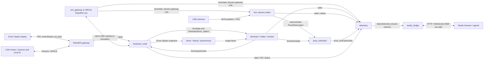

# Robot data flow and byte budgets

This is the wire/slot contract, not the native `sizeof(State)` or a claim about
Ethernet airtime. Bytes below exclude UDP/IP/Ethernet overhead unless explicitly
included. Changes to a frame, codec, device cap, slot, or telemetry budget must
update this document and its matching compile-time assert in the same change
([hard rule](../.omp/RULES.md)). Fully populated encoder tests pin the State,
Command, and Driver Station formulas to the actual encoders.

## Processes and links

All robot logic runs on the main processor. The RIO owns devices and the native
Driver Station interface. Camera images go directly to the main processor, not
through the RIO. All arrows between main-processor nodes are shared memory, not
network sockets. The simulation gateway replaces the RIO; it does not add a
second hop. See [architecture](../ARCHITECTURE.md#two-processors).

### Link rates and endpoints

| Link / direction | Transport / port | Trigger or rate in the 2026 configuration |
|---|---|---|
| Devices ↔ RIO backend | CAN / local DIO, analog, encoder, PWM; no IP port | Gateway samples/applies on `Config.period_us`: 5000 µs = 200 Hz. Vendor CAN status frequencies are device configuration, not a separate talOS packet rate. |
| Driver Station ↔ RIO | WPILib/FRC native control/status over radio; not talOS UDP | DS produces new data at 50 Hz; RIO refreshes WPILib each hardware tick, emits a talOS DS snapshot at most every 20000 µs. Native FRC packet layouts are external to this repo. |
| RIO → hardware_node: State (type 20) | UDP source gateway 5802 → bridge 5803, wired robot switch | One snapshot per gateway tick, 200 Hz. |
| hardware_node → RIO: Command (21) | UDP 5803 → 5802 | Bridge polls every 1000 µs. Send immediately when merged command changes, otherwise heartbeat `clamp(command_timeout_us / 5, 5000, 20000)` µs: 20000 µs = 50 Hz with the configured 100000 µs timeout. Only after observed state and while a subsystem request is active; not unconditionally 1000 Hz. |
| hardware_node → RIO: Config chunks (22) | UDP 5803 → 5802 | Whole config push on observed boot/config mismatch or while unacknowledged; retry when a State arrives and ≥50000 µs since last push, immediately for a changed boot ID. Not periodic after successful matching acknowledgment. |
| RIO → hardware_node: ConfigAck (23) | UDP 5802 → 5803 | On completed assembly/reconfiguration or rejected chunk/config; no per-chunk ACK for incomplete assemblies. |
| RIO → hardware_node: DriverStation (24) | UDP 5802 → 5803 | ≤50 Hz on real RIO and standalone `sim_gateway`: snapshots are gated to ≥20000 µs apart, independently of the hardware tick. |
| hardware_node → device-owning nodes / DS consumers / telemetry | Shared-memory `/hw/state`, `/hw/state/driver_station`, `/hw/status`; no port | State/DS on received frames; bridge status first tick then every 20000 µs (50 Hz, `node.h`'s `kStatusPeriodUs`). Consumers run at their own periods. |
| drivetrain / shooter / intake → hardware_node | Shared-memory `/hw/request/<node>` | Devices-layer flush each update: drivetrain and shooter 5000 µs (200 Hz); intake 20000 µs (50 Hz). Bridge neutralizes an owner silent for >2× its period. |
| driver / teleop / autonomous → actuator nodes | Shared-memory target lanes | 20000 µs (50 Hz); mode/freshness policy selects one lane. `driver` produces chassis control; `teleop` provides configured mechanism control; autonomous supplies auto lanes. |
| Camera → camera node | USB capture, AVFoundation on macOS / V4L2 on Linux; no port | Requested capture rate 60 fps; capture/processing workers run at camera availability. Node period 10000 µs (100 Hz) does not guarantee 60 fresh images/s. |
| Camera nodes → pose_estimator / telemetry | Shared-memory `/<camera>/state`, `/<camera>/status` | Four configured camera nodes: status each 100 Hz node tick; live observations once per processed frame, up to 60 fps, not republished at the node rate. |
| drivetrain → pose_estimator | Shared-memory `/drivetrain/state` | 200 Hz publication; estimator updates every 20000 µs (50 Hz), fusing latest odometry and new valid camera observations. |
| `sim_gateway --physics` → simulated cameras / telemetry | Shared-memory `/sim/state` | Every physics/hardware tick (200 Hz); main-processor node-clock timestamp, true field pose and field-frame velocity. No writer under ideal or WPILib/RoboRIO simulation. |
| Nodes → telemetry → studio_bridge | Shared-memory states/statuses → `/talos/telemetry` byte topic | Telemetry period 10000 µs = 100 Hz; dictionary first frame and every 100th frame (1 Hz at this rate). |
| studio_bridge ↔ browser/agent | HTTP + WebSocket, configured port 5800 | Forwards telemetry frames as available; initial graph/dictionary on connection. HTTP requests and graph refresh are not the 100 Hz value stream. |

Camera observation timestamps describe exposure, not publication. Measure each
camera's timestamp delay during bring-up and set its `[camera] latency_offset_us`
(default 0): live and sim both subtract this offset from the capture stamp.
`last_latency_us` measures node time minus that corrected stamp. Sim-only
`camera.sim_timestamp_lag_us` (default 0, ignored live) adds known stamp bias and
delays delivery until the biased stamp's instant; equal offset restores the
original truth stamp without removing delivery delay. Both values must be
finite, nonnegative and below one second. Underflow/future stamps publish invalid.

Timing sources: `2026-robot/main_processor/configuration/robot.toml:1-16`, its
`subsystems/*.toml`, `talOS/bridge/node.cc` (`Tick`, `PushConfig`,
`ShouldSendCommand`), `talOS/hardware/endpoint.h:25-98`,
`2026-robot/controller_processor/rio/src/main/cpp/Robot.cpp:221-258`, and
`2026-robot/main_processor/simulation/sim_gateway.cc`.

## UDP frame and payload sizes

One datagram contains exactly one protocol frame. The explicit little-endian
header is **40 B**: magic u64 (8), version/header_size/type/flags u16 (8 total),
sequence u64 (8), monotonic_time_us u64 (8), payload_size u32 (4), reserved u32
(4). Payload maximum is **1432 B**; frame maximum **1472 B** = 1500-byte MTU −
20-byte IPv4 header − 8-byte UDP header. Under this IPv4/MTU contract talOS frames
need no IP fragmentation (`talOS/protocol/frame.h`, `frame.cc`, `types.h`).

| Payload | Fixed vs dynamic formula (bytes) | Maximum payload | Maximum frame | Payload headroom |
|---|---|---:|---:|---:|
| State, type 20 | `58 + 47M + 27S + 4DI + 4DO + 15AI + 23E + 11PWM + 34` | 1412 | 1452 | 20 |
| Command, type 21 | `38 + 20M + 3DO + 10PWM` | 410 | 450 | 1022 |
| Config chunk, type 22 | packed 24-byte header + ≤1408 data | 1432 | 1472 | 0 for full chunk |
| ConfigAck, type 23 | packed u64 config_id + u8 status + char[64] reason | 73 | 113 | 1359 |
| DriverStation, type 24 | 32 fixed + two FMS strings + six variable joysticks | 670 | 710 | 762 |

State/Command maxima use caps **M=16, S=12, DI=8, DO=4, AI=4, E=4,
PWM=4** (`talOS/hardware/config.h`). The 58-byte State prefix is five u64 +
u32 flags + seven u16 counts; its 34-byte suffix is health (18) + four u32
counters (16). Command prefix is four u64 + three u16 counts = 38.

| Device | State bytes / device | Command bytes / device | Encoded fields |
|---|---:|---:|---|
| Motor | 47 | 20 | State: id2 + valid1 + four doubles32 + three u32 fields12. Command: id2 + mode1 + slot1 + demand8 + feedforward8. |
| Sensor | 27 | — | id2 + valid1 + two doubles16 + two ages8 |
| Digital input | 4 | — | id2 + valid1 + value1 |
| Digital output | 4 | 3 | State id2 + valid1 + value1; command id2 + value1 |
| Analog input | 15 | — | id2 + valid1 + voltage8 + age4 |
| Encoder | 23 | — | id2 + valid1 + position8 + velocity8 + age4 |
| PWM output | 11 | 10 | State id2 + valid1 + output8; command id2 + output8 |

These are codec sizes (`talOS/hardware/messages.h`, `messages.cc`), not native
struct padding. Binary64 values remain binary64 on the wire.

### Actual 2026 robot

The canonical parser merges `2026-robot/main_processor/configuration/robot.toml`
and its subsystem files. Current device counts are **10 motors, 5 sensors,
2 digital inputs, 0 digital outputs, 0 analog inputs, 0 encoders, 0 PWM outputs**.

- State: `58 + 10×47 + 5×27 + 2×4 + 34` = **705 B** payload,
  **745 B** frame, **727 B** payload headroom.
- Command: `38 + 10×20` = **238 B** payload, **278 B** frame,
  **1194 B** payload headroom.
- Serialized Config: **3231 B**; `ceil(3231 / 1408)` = **3 chunks**.
  Chunk data lengths **1408, 1408, 415 B**, payload lengths **1432, 1432,
  439 B**, datagram lengths **1472, 1472, 479 B**. One push is **3423 B**
  of talOS frames (`3231 + 3×24 + 3×40`), excluding UDP/IP headers.
- State at 200 Hz: **149000 B/s** in talOS frames (`745×200`), or
  **1.192 Mbit/s**, on the wired internal link, not the robot radio.

Computed with a throwaway C++ program calling the production `ParseRobotConfig`,
`SerializeConfig`, and `CreateConfigChunks`, and the named State/Command size
formulas; source/binary were removed after measurement. `robot_field.toml`
produced the same counts and sizes. This measures the real string/config codec,
not a TOML text-length estimate.

## Dynamic and multi-frame messages

**State and Command:** Count prefixes select the occupied array entries; unused
capacity is not serialized. A State or Command is always wholly contained in
one datagram. Invalid counts, truncated data, and trailing bytes are rejected
by decoding; cap-sized encoder tests assert exact named worst-case lengths.

**Driver Station:** The fixed portion is **32 B**, including sample/mode times,
FMS fixed fields, two string-length bytes, and joystick count. Event and game
message strings each transmit at most **31 B** (their storage is 32 including
NUL). Each of the six joysticks is **1 B** when disconnected. Connected cost is
`1 connected + 3 counts + 4 buttons + 4×axes + 2×POVs + 1 name_length + name`.
At caps (12 axes, 4 POVs, 31 name bytes) this is **96 B** each; maximum is
`32 + 31 + 31 + 6×96` = **670 B**; empty strings/all disconnected is **38 B**.
Source: `talOS/driver_station/driver_station.h` and `.cc` (`Encode`).

**Config:** `SerializeConfig` is a variable-length, count/string-prefixed codec.
Each chunk carries config_id, CRC32 of the entire serialized config, total byte
count, chunk index/count, and chunk data length. `ConfigAssembler` accepts chunks
out of order, ignores duplicate chunks, waits until all indices are present,
checks CRC32, deserializes and validates caps, then reconfigures. A new config ID
replaces the assembly; inconsistent metadata or invalid assembled data is
rejected. Completion/backend failure or malformed data produces the 73-byte ACK
with status/reason (`config_wire.h`, `endpoint.h`).

There is no selective retransmission or hot-path fragmentation protocol. A lost
chunk leaves an incomplete assembly with no success ACK; the bridge repeats the
whole config at its 50 ms retry gate while State indicates mismatch or no matching
success ACK. Lost ACK likewise causes a whole-push retry. Existing valid control
configuration is not replaced by a partially assembled transfer. All frame flags
are zero in these runtime send paths: AckRequested/Ack/Fragment are declared but
unused; ConfigAck is a frame type, and chunking is payload-level, not the Fragment
flag. Sequence numbers still expose datagram gaps.

**Known byte-order inconsistency:** ConfigChunkHeader and ConfigAckPayload are
packed structs copied with `memcpy`, so they use host byte order. Serialized
Config, State, Command, DS, and protocol frame fields explicitly write
little-endian. Both current endpoints are little-endian; this document records
the inconsistency without changing the wire format.

## Main-processor shared-memory slots

Fixed message topics store their complete native FlatBuffers struct/envelope;
there is no UDP frame header. Slot bytes are not the dynamic occupied payload
length. Queue bookkeeping/ring headers are additional to the per-slot bytes.

| Topic / owner → consumer | Slot bytes | Meaning / rate |
|---|---:|---|
| `/hw/state`: bridge → devices/telemetry | 1436 | `hardware::Packet`: u32 size + 1432 data; occupied data currently 705, ≤1412 |
| `/hw/command`: bridge → observers/logging | 1436 | Packet; merged Command occupied data currently 238, ≤410 |
| `/hw/state/driver_station`: bridge → DS consumers/telemetry | 1436 | Packet; DS occupied data 38–670 |
| `/hw/request/<node>`: device owner → bridge | 1436 | Packet; only that owner's actuator requests, not a full-capacity command |
| `/hw/status`: bridge → telemetry/observers | 160 | fixed `bridge.BridgeStatus`, alignment 8 |
| `//target/<source>`: producer → target resolver | `16 + sizeof(message)` | TargetEnvelope mode-generation/active header 16 + FlatBuffers struct; chassis 40, shooter 24, intake 20 |
| `/autonomous/state`: autonomous → telemetry | 1 | AutonomousState: phase enum (ubyte) |
| `/drivetrain/state`: drivetrain → estimator/driver/telemetry | 112 | DrivetrainState: padded time/flags header 16 + chassis/yaw 32 + four module positions 64 |
| `/intake/state`: intake → telemetry | 20 | IntakeState, including FlatBuffers padding |
| `/shooter/state`: shooter → telemetry | 32 | ShooterState, including FlatBuffers padding |
| `/<camera>/state`: each camera → estimator/telemetry | 64 | geometry.PoseObservation, including padding |
| `/<camera>/status`: each camera → telemetry | 56 | vision.VisionStatus, including padding |
| `/pose_estimator/state`: estimator → telemetry | 72 | geometry.PoseEstimate, including padding |
| `/sim/state`: physics sim_gateway → four simulated cameras / telemetry | 56 | geometry.OdometrySample: sample_time_ns + Pose2d + Twist2d; 200 Hz, always valid while published; absent with ideal or WPILib/RoboRIO simulation |
| `/talos/telemetry`: telemetry → studio_bridge | 16384 × 64 slots | byte ring = 1048576 B of slot storage; actual frames have padding stripped before WebSocket forwarding |

Sources: `talOS/hardware/packet.h`, `talOS/bridge/bridge_status.fbs`,
`talOS/devices/target.h`, `talOS/msgs/geometry.fbs`, robot `*_message.fbs`,
`vision/vision.fbs`, and `talOS/telemetry/wire.h`. Struct sizes include alignment
padding: they must not be inferred by simply adding scalar field widths.
The `/sim/state` slot is pinned by `static_assert(sizeof(geometry::OdometrySample)
== 56)` in `simulation/sim_gateway.cc`. This truth topic is local to the main
processor and never crosses the hardware UDP link.

## Telemetry, Studio, and the radio boundary

Telemetry emits size-prefixed FlatBuffers `Frame`s: a **4-byte** little-endian
length followed by a `TLM2` buffer. Value-only frames are dynamically sized by
channel count but limited to **1200 B including the prefix**; the producer builds
a worst-case frame at startup and refuses an over-budget dictionary. Dictionary
frames are larger/variable, bounded by the **16384 B** slot. First/every-100th-frame
dictionaries allow late join/recovery in about a second at 100 Hz.

The 2026 four-camera configuration excludes the cumulative captured, processed
and range-rejected camera counters at channel level, retaining camera health,
timing, dropped-frame and visible-tag diagnostics. The producer's
`MeasureValueFrameBytes` over the original real declared graph measured
**141 channels / 1216 B** before exclusions and **129 channels / 1120 B** after.
In a physics-gateway session `/sim/state` adds **7 channels**: `sample_time_ns`,
pose x/y/yaw and velocity vx/vy/omega. At 8 B/channel that is **136 channels /
1176 B**, leaving **24 B headroom** under the 1200 B cap; no additional excludes
are needed. Non-physics sessions remain at 129 channels / 1120 B. The full-stack
startup test runs the declared physics graph, so telemetry's construction-time
`CheckFrameBudget` enforces the cap on that graph. Topic-level includes remain
unchanged; excludes match topics or individual dictionary channels, and only
retained channels count toward the budget.

Studio's bridge forwards the occupied frame, not 16384 bytes of padding. At the
value cap, `1200×8×100` = **0.96 Mbit/s per connected client**, before TCP/IP,
WebSocket, retransmission, dictionary and graph overhead. The value cap leaves
room under a normal MTU, but TCP is a byte stream: segmentation/coalescing is not
a guaranteed one-WebSocket-frame-per-IP-packet contract. Dictionary frames can
span multiple TCP segments.

The `[studio]` HTTP/WebSocket port is **5800**. Browser traffic to a driver laptop
crosses the robot radio and shares the team's field allocation with DS, other
telemetry and video. RIO↔main-processor UDP stays on the robot's wired switch and
is not charged against wireless throughput. Local USB camera images also do not
consume that budget unless separately streamed off-robot (this path does not).

The existing telemetry README's R704 reference is supported by
[WPILib's bandwidth guidance](https://docs.wpilib.org/en/stable/docs/networking/networking-introduction/measuring-bandwidth-usage.html),
which explicitly identifies R704 in the 2026 manual and uses a 4-Mbit reference
budget. Thus 0.96 Mbit/s is 24% of that **planning reference**, not a guaranteed
per-client allowance or an overhead-inclusive measured total. The actual event's
current radio/manual allocation remains authoritative; a wired internal link is
not subject to the wireless allocation.

## What never crosses the hardware UDP link

Only hardware State, merged actuator Command, Config chunks/ACK, and Driver
Station snapshots cross ports 5802/5803. In this robot only **drivetrain, intake,
and shooter** own devices and produce `/hw/request/<node>`; the bridge builds
request subscriptions from device ownership. Vision, pose_estimator, autonomous,
teleop, driver, and telemetry do not produce hardware requests. Targets,
camera images/observations/status, estimated pose, node state/status, and telemetry
frames stay on the main processor (telemetry subsequently travels to Studio on a
separate WebSocket connection). The camera nodes have no `/hw/*` source.

## Why one datagram per hardware tick?

A State is an atomic snapshot with one sample_time/config_id (and boot/epoch),
so consumers do not combine half-old and half-new device state. There is no
reassembly on the control hot path. A dropped datagram loses one snapshot, not a
piece that stalls the loop; freshness gating handles continued loss. Requests
retain the hardware identity/time they observed, the gateway rejects stale or
wrong-identity commands, and disabled/stale-target actuation is neutralized.
The configured command timeout is **100 ms**; a single loss does not imply an
immediate timeout. The maximum frame fits the IPv4 MTU without fragmentation.

The cost is a hard device-cap budget tied to one datagram: State has only **20 B**
worst-case headroom. Grow in this order if required: first narrow appropriate
telemetry-only binary64 fields to float32 (an explicit wire/version change), then
split State by CAN bus using an **all-parts-or-drop multipart snapshot** with a
shared identity/time. Neither growth option is implemented today; silently
raising caps or sending partial snapshots is not an acceptable substitute.
