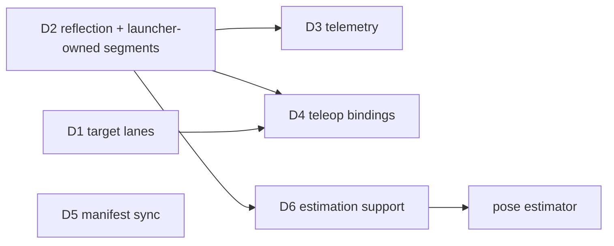

# Design: automatic wiring (no arbiter, no hard-coded subsystems)

Status: partially implemented checkpoint, not acceptance-complete. See
[HANDOFF_AUTOMATIC_WIRING.md](HANDOFF_AUTOMATIC_WIRING.md) for current evidence,
remaining work, and completion order. The rules it serves are in
[METHODOLOGY.md](METHODOLOGY.md). D2 has its first stage (build-level
descriptors and the field-name lint). D6 is implemented except
`--replay-inputs`, which waits for D2's descriptor-bearing logs. The rest of
D2, and D3 and D4, remain proposals.

## Problem

Robot-wide wiring is code that lists subsystems by name. Adding a subsystem
means either editing that code or squeezing through a generic side door.

| Where | What is hard-coded |
|---|---|
| `2026-robot/main_processor/arbiter/arbiter.h:9-14,88-94,100` | includes and lanes for drivetrain, shooter, intake; everything else via `arbitrate = true` and a hand-mirrored `GenericTarget` |
| `operator_interface/operator_interface.h:11-16,53-58,75` | the same three subsystems; extras via `teleop_button`/`teleop_demand` and a second `GenericTarget` copy |
| `telemetry/node.h:120-129,325-393` | channels for five subsystems by name; extras via `telemetry = true` and a hand-mirrored `GenericState` |
| `main_processor/BUILD:9-27`, `configuration/BUILD:33-46`, `robot.toml` | three copies of the node list |
| `talOS/launcher/launcher.h:781` | the subsystem name `telemetry` |

On top of that, the arbiter is a process every actuator depends on: if it
dies, every target goes stale. It also adds a hop, measured at 3.0 ms median
(p99 5.1 ms) from arbiter to drivetrain.

## Goals

- Adding a subsystem, a producer, or a hardware-less process (pose estimator,
  vision, autonomous) is a node package, its TOML and one `[[subsystems]]`
  line. No other file changes, in any language.
- No node lists other subsystems by name. Every cross-cutting behaviour is
  derived from config plus self-describing topics.
- Each subsystem's safety keeps depending only on its own process and the
  bridge.
- Replay stays deterministic.
- Use existing open-source pieces where they fit (METHODOLOGY §14):
  FlatBuffers reflection for schemas, wpimath for estimation.

Non-goals: changing the hardware path (bridge, gateway, RIO), or Studio's UI
beyond reading descriptors.

---

## D1. Target lanes, resolved inside the consumer (replaces the arbiter)

**Status: implemented; the safety contract holds in tests and in a live sim.**
`talos::Target`/`TargetLane`/`TargetEnvelope` exist in `talOS/devices/target.h`,
with the C ABI (`talOS/node_api`), Python wrappers, test helpers, configuration policy,
and graph lane checks. The arbiter is deleted. Envelopes carry the Driver
Station mode generation (below), so a target from an earlier enable or mode
never actuates. Each Target's selected source is reported in its node's
registry row and shown in Studio's system view. The operator-interface
`GenericTarget` remains until D4; see [the handoff](HANDOFF_AUTOMATIC_WIRING.md).

The pattern is ROS's `twist_mux`: several input lanes, a priority order, a
timeout on each lane, and the highest-priority live lane wins. Here it is
built into the consuming node instead of running as a separate process.

### Topics

Producers write `/<sub>/target/<source>` (`teleop`, `auto`, `align`, ...).
NAMING.md already allows this. The aggregate `/<sub>/target` topic goes away.
Each lane carries a framework envelope around the user struct:

```
struct TargetEnvelope<M> {
  uint64 mode_since_us;   // the producer's Driver Station mode generation; 0: it had none
  uint8  active;
  uint8  padding[7];      // zero
  M      message;         // offset 16
}                         // size = 16 + sizeof(M); alignment = alignof(M)
```

`active = 0` means "this producer has nothing to say". That replaces the
`enabled` field in every target struct, and it replaces the arbiter's
"send stop once on mode change". `mode_since_us` is held as bytes in the C++
struct so the envelope keeps `M`'s alignment (a 4-byte `M` is a 20-byte lane).

### Mode generation

Invariant: a target issued under an earlier Driver Station enable or mode can
never actuate. Receipt time cannot enforce it: every message delivered in one
drain shares the drain's timestamp, so a target queued before a mode change is
indistinguishable, by time, from one derived from the packet that changed the
mode. The generation is therefore carried end to end:

- Every Driver Station sampler (the RoboRIO program, real and WPILib-sim
  alike; `SimHardware`; `send_joystick`) runs one
  `driver_station::ModeTracker`, which stamps `DriverStationData::mode_since_us`
  with the `sample_time_us` of the first sample whose mode key (attached,
  enabled, e-stop, autonomous, teleop, test: `driver_station::ModeKey`)
  differs from the previous sample's; never 0, and strictly later than the
  previous generation. The bridge forwards the packet unchanged.
- A node's generation is its latest packet's `mode_since_us` while its
  Driver Station mode is not none (fresh, attached, enabled, not e-stopped),
  else 0.
- `TargetLane::send` stamps the producer's generation; `release()` sends
  `active = 0`.
- `Target::get` accepts a lane only when its stamp is nonzero and equal to
  the consumer's generation.

A Driver Station link that drops and returns while the RoboRIO stays in the
same mode keeps its generation, so a producer that kept talking drives again as
soon as its lane is fresh; re-enabling or re-attaching starts a new one, and
the old lane stays ignored until the producer resends from the new packet. A
producer and its consumer drain the same packet independently, so for at most
one consumer period after a mode change a lane can be rejected because one of
them has not drained it yet: conservative, never unsafe.

### Policy (TOML, no code)

```toml
# robot.toml: default for every subsystem. DS mode -> lanes, highest priority first.
[robot.targets]
teleop = ["teleop"]
autonomous = ["auto"]
test = []            # pit tests opt in: test = ["test"]

# subsystems/drivetrain.toml: override for one subsystem
[targets]
teleop = ["align", "teleop"]   # auto-align preempts the driver while it is active
```

### Selection, on every drain (deterministic: inputs are the node's own logged messages)

```
mode       = DS mode     (none if the DS is stale, detached, disabled or e-stopped)
generation = latest DS packet's mode_since_us while mode is not none, else 0
selected = first lane L in policy[mode] whose latest envelope
           is younger than command_timeout_us,
           has active = 1, and
           has mode_since_us != 0 and == generation
get()    = robot_enabled(node) && selected ? &selected.message : null
```

- Same generation: an `auto` target from before teleop began, or a teleop
  target from before a disable, can never drive this teleop period, even when
  it arrives in the same drain as the packet that started it.
- `active = 0` falls through to the next lane at once, so releasing an
  auto-align returns control to the driver on the next tick, not after
  100 ms.
- No callback: the node keeps draining just before its timer (no 1 ms
  polling), and selection runs in that drain.

### API (one C++ implementation in `talOS/devices`, wrapped by the C ABI and Python)

```cpp
talos::Target<control::PositionTarget> target_{node};      // lanes /<node>/target/<source> from the policy
if (const control::PositionTarget* t = target_.get()) { motor_.set_motion_magic(t->position_rot()); }
target_.source();                                           // "teleop", "auto", ... or "" when inactive

talos::TargetLane<control::PositionTarget> lane_{node, "wrist", "auto"};  // writes /wrist/target/auto
lane_.send(control::PositionTarget{0.25, 0.0});
lane_.release();                                            // active = 0
```

```python
self.target = talos.Target(node, PositionTarget)
t = self.target.get()                                       # None when inactive
self.lane = talos.TargetLane(node, PositionTarget, "wrist", "auto")
self.lane.send(position_rot=0.25); self.lane.release()
```

C ABI (`node_api.h`, ABI version bump):
- `talos_target_open(node, bytes, align)`
- `talos_target_get(target, out, &source_index)`
- `talos_target_source_name(target, index)`
- `talos_target_lane_open(node, subsystem, source, bytes, align)`
- `talos_target_lane_send(lane, msg)`
- `talos_target_lane_release(lane)`

The selected source is reported in the node's registry row, so Studio shows
who is driving each subsystem: every `get()` records the selected lane's index
(one relaxed atomic, stored only when it changes), the reporting thread copies
it into the row's selection records (`talOS/introspection/registry.h`,
`kRegistryVersion` 2), and the bridge's system graph carries it as
`nodes[].selections[] = {sources, selected}` with `selected: null` when
nobody drives.

### Graph lint (`talOS/introspection/names.h`)

| Check | Severity |
|---|---|
| A lane writer whose `<source>` is in no policy for that subsystem (a dead producer) | error |
| A mode's lane with no writer (e.g. nothing writes `/drivetrain/target/auto`) | warning |
| A subsystem writing its own lane | error (existing "target is written by anyone but the owner") |
| Lane sizes, as `envelope(M)` at both ends | error (existing size check; D2 upgrades it to a schema hash) |

### Removed

- the `arbiter` package and `subsystems/arbiter.toml`;
- the arbiter's `GenericTarget`; the operator-interface copy remains until D4;
- the `arbitrate` key;
- `enabled` in target structs;
- the scaffold's arbiter edits.

### Rejected alternatives

- **A generic arbiter node** that the launcher configures from the graph and
  that forwards bytes. It keeps the extra hop and the single point of
  failure, and it puts the mode in one process and the lanes' ordering in
  another (the current code needs subscription-order tricks for this).
- **A lane priority field inside the message.** That makes producers agree on
  numbers. Priority belongs to the consumer's config.

### Acceptance

- `Sim` tests in C++ and Python cover: teleop drives; a mode switch ignores the
  old lane; a target queued before a re-enable is rejected in the same drain
  as the re-enabling packet while one stamped with the new generation is
  accepted; a producer with no mode stamps 0 and never drives; DS loss goes
  neutral and same-mode recovery keeps the generation; re-attach starts a new
  one; a stale high-priority lane falls back to the next; `release()` falls
  through within one tick; `[subsystems.<name>.remap]` redirects one lane.
- The 2026 graph launches without the arbiter, and `--describe-only` is clean.
- Live sim: stick → drive request median drops by the arbiter hop (baseline
  4.98 ms), and the fault table from the LiveSim run still holds.

---

## D2. Self-describing topics (FlatBuffers reflection)

**Status: stage 1 implemented (descriptors and field-name lint); attach
checks, launcher-owned segments, descriptor-bearing logs and the reflection
codec remain.** `talos_messages` compiles each schema to `<file>.bfbs` with
`flatc --binary --schema --bfbs-filenames` and lints it in the same action
(`talOS/build/descriptor_gen.cc` against `talOS/schema/unit_suffix.h`). It
generates `<prefix>/<file>_descriptor.h` specializing `talos::Descriptor<M>`
(`kName`, `kHash`, `kBfbs`; `talOS/schema/descriptor.h`) and appends
`TALOS_SCHEMA_NAME`/`HASH`/`BFBS` to each flatc Python class. The hash
(`talos::schema::struct_hash`, Python `talos_schema.struct_hash` over
`reflection` classes generated from upstream `reflection.fbs`) is FNV-1a 64
of a canonical text of the struct's reflection object: field names, types,
offsets, nested structs and enums, size and alignment. `--bfbs-gen-embed`
is not used: 25.12.19 requires a table root, so the generator embeds the
bytes itself. `//talOS/schema:schema_hash_test` and `:schema_hash_py_test`
check parity and that same-size changes move the hash.

Today a topic is checked by size alone (`names_test.cc:433` says so), and every
generic consumer needs compile-time types. Instead, use FlatBuffers'
own reflection:

- `talos_messages` additionally runs `flatc --binary --schema` to produce
  `<file>.bfbs` (a `reflection.Schema`), and generates
  `talos::Descriptor<M>` (C++: the embedded `.bfbs` bytes plus the root
  struct name) and the same bytes for Python.
  - C++ reads it with `flatbuffers/reflection.h`.
  - Python reads it with classes `flatc` generates from upstream
    `reflection.fbs`. The pip wheel (25.12.19) does not ship them; the
    `@flatbuffers` module source does.
- **Launcher-owned segments.** At startup the launcher creates every declared
  topic segment with its size, slots and descriptor (from `--describe`), and
  unlinks them at session end. Nodes only attach. This also fixes segment
  lifetime (HotPath C8: a creator that exits cleanly unlinks under its peers).
- **Attach checks a schema hash** (the hash of the struct's reflection
  object), not just size. A mismatch fails, naming both types.
- **`.tlog` files carry descriptors** at session start, so `log_dump` can
  decode payloads (an open TODO) and the `.tlog` → MCAP export can emit typed
  channels.
- **The Python codec** (`_messages.py`) reads layout from reflection instead of
  recording `Create<Struct>` calls. The recorder heuristic is deleted.
- **Field-name lint** against the METHODOLOGY §6 suffix table runs in the
  `talos_messages` action and fails the build.

**Acceptance:**
- `log_dump` prints decoded fields for every topic.
- A deliberately changed field type with the same size is rejected at attach.
- The Python codec tests pass on reflection alone.

---

## D3. Telemetry from descriptors (framework node)

`//talOS/telemetry:node` replaces the robot's telemetry node. It holds no
subsystem names.

- **Sources.** Every `state` and `status` topic in the declared graph (the
  launcher hands the graph to it). It is an *observer*: it attaches read-only
  and the lint does not count it as a consumer. Adjust with
  `[telemetry] include` / `exclude` globs.
- **Channels.** `<owner>/<role>/<field>`, e.g. `shooter/state/velocity_rps`.
  Nested structs flatten with `/`.
  - The unit comes from the suffix, so the hand-written `"rev/s"` strings
    disappear.
  - Enum labels come from the reflection enum.
  - Bools encode as 0/1.
  - Stale or absent becomes NaN, as today.
- **Frame pose.** `[studio] pose_topic` names the topic whose
  `geometry.Pose2d` field fills the Frame's chassis pose.
- **Budget.** The existing construction-time frame-size check stays. It now
  fails with the list of the largest sources.
- **Launcher.** It finds the watched topic via `[studio] topic` instead of
  `kStudioBridgeName` and the hard-coded `telemetry` name.

**Removed:** `GenericState`, the `telemetry`/`telemetry_unit` keys, and the
robot's telemetry package.

**Acceptance:** a scaffolded subsystem appears in Studio with correct units and
no edits outside its own package.

---

## D4. Declarative teleop bindings (framework node)

`//talOS/teleop:node` reads each subsystem's `[teleop]` table and writes that
subsystem's `teleop` lane. It encodes by field name through the lane's
descriptor.

```toml
# subsystems/wrist.toml
[[teleop.bindings]]
button = 3                     # joystick 0 unless port = N; 1-based like the DS
while_held = { position_rot = 0.25 }

[[teleop.bindings]]
axis = 1
field = "velocity_rps"
scale = 60.0                   # in the field's unit
deadband_frac = 0.05
```

Semantics:
- While a binding is live, it sends `active = 1` with the given fields; the
  other fields are zero.
- With no live binding, it calls `release()`.
- It sends nothing while the DS is disabled, not in teleop, or the stick is
  disconnected.

Chassis driving (deadband, field-oriented rotation, pose) stays robot code: a
small `driver` node writing `/drivetrain/target/teleop`. It is the current
`operator_interface` without its mechanism bindings.

**Removed:** `teleop_button`/`teleop_demand`, the remaining `GenericTarget`, and
the mechanism code in `operator_interface`.

**Acceptance:** a Python wrist gets a button by TOML alone, and the live sim shows
its lane active.

---

## D5. The manifest is the single source (implemented)

- `robot.toml` `[[subsystems]]` is the only node list.
- `bazel run //tools:sync_manifest -- <dir>/robot.toml` writes
  `<dir>/robot_manifest.bzl` beside the config (`<stem>_manifest.bzl` for
  other names, e.g. `robot_py_manifest.bzl`): `NODES`, the node labels, and
  `CONFIG_FILES`, every file the config reads besides itself (`include`,
  `path`, `defaults`). It is a short Python `tomllib` script
  (`tools/sync_manifest.py`), the only reader besides the C++ parser, and
  ports the parser's resolution step for step: top-level and entry keys,
  duplicate names, value types, and `include`/`node`/`defaults` precedence.
  The cases under `talOS/configuration/testdata` (a config tree plus
  `expect.toml`: accept or reject, nodes, files read) run through both
  `//talOS/configuration:test` and `//tools:sync_manifest_test`, so the two
  readers cannot disagree untested. It rejects absolute and
  workspace-leaving paths, which have no Bazel label.
- `talos_bundle` (`nodes`, `config_files`) and `talos_graph_test` (`nodes`,
  `data`) take `NODES` and `CONFIG_FILES`.
- `manifest_sync_test` (`tools/sync_manifest.bzl`) runs the script with
  `--check` and fails, with the regenerate command and a diff, when the
  manifest is stale. It sees only the files `CONFIG_FILES` lists, so an entry
  naming a new file fails too.
- `new_subsystem` edits `robot.toml`, writes the subsystem file and
  regenerates its manifest and that of every other config in the robot that
  includes it. It edits no BUILD file. Existing names and the placeholder CAN
  id come from the effective config (includes, defaults, custom paths).
  `tools/scaffold_testdata` holds its output for one C++ and one Python
  package; `bazel test //...` builds and tests them, and
  `new_subsystem_test` fails when the generator's output drifts from them.
- `new_subsystem --standalone DIR` writes a Bzlmod repo that builds as
  written: `local_path_override` to the generating checkout plus its
  `.bazelrc` and `.bazelversion`. A robot consumes it with `bazel_dep` +
  `local_path_override` and names `@<name>//:node` in its own subsystem file.
- Bundling stages every config file at its path relative to the config, so
  `defaults = "..."` files and non-default `path`s resolve in the bundle.
  `config_sha256` covers each staged file's config-relative path and bytes,
  the root config's included (docs/DEPLOYMENT.md);
  `//2026-robot/main_processor:bundle_test` describes relocated copies of
  the robot bundle and of `bundle_testdata/robot.toml` (include,
  parent-directory defaults, custom path, entry node).

**Acceptance:** adding a `[[subsystems]]` line without running the sync fails
CI with the fix printed.

---

## D6. Estimation support, and adding a pose estimator

What a pose estimator needs, and where each piece now lives:

| Need | Before | Now |
|---|---|---|
| Wheel module positions (distance, angle) | `DrivetrainState` had chassis speeds only | `module0`..`module3: geometry.SwerveModulePosition` (`distance_m`, `angle_rad`) in `[subsystems.drivetrain.geometry].modules` order, plus `modules_valid` |
| Gyro heading with validity | `yaw_rot`, which read 0 when disconnected | `yaw_rad` + `yaw_valid` |
| When a sample was taken | `timestamp_ns` = publish time | `sample_time_ns`, from `HardwareLink::sample_time()`: the gateway's `sample_time_us` mapped into the node clock (the bridge keeps a min-filtered offset). C++, C ABI and Python. |
| Vision observations | none | `geometry.PoseObservation { sample_time_ns, pose: Pose2d, x_std_m, y_std_m, yaw_std_rad, tag_count, valid }` in `talOS/msgs` |
| Estimator output | `odometry.OdometryState` | `geometry.PoseEstimate { sample_time_ns, pose, velocity: Twist2d, valid, observation_accepted_count, observation_rejected_count }` |
| Estimator math | hand-written dead reckoning (`odometry`, deleted) | `pose_estimator` (Python): wpimath or GTSAM, chosen by `backend` |
| A topics-only package | `talos_messages` needed a schema | `talos_messages(srcs = [], topics = ..., deps = ["//talOS/msgs:geometry"])` |
| A list parameter (`cameras = [...]`) | `param<T>` took bool, integer, double or string only | `param<std::vector<std::string>>` / `std::vector<double>`, in the C ABI and Python (`node.param("cameras")` is a list) |
| Offline tuning | `--replay` replays a node's own log | `--replay-inputs <session>` (drive a *new* node from another session's logged topics) is not built yet |

### The 2026 robot's estimator

`2026-robot/main_processor/pose_estimator` is one Python node with two
backends behind one shell. The shell owns the inputs, the checks and the
output; a backend only folds in odometry and observations:

- `backend = "kalman"`: `wpimath.estimator.SwerveDrive4PoseEstimator` from
  `robotpy-wpimath` (the C++ class is `frc::SwerveDrivePoseEstimator<4>`;
  there is no `SwerveDrive4PoseEstimator` in C++). A steady-state Kalman gain
  from `kalman.state_std_*` and each observation's standard deviations, with
  latency compensation by replaying buffered odometry. Odometry goes in only
  through `updateWithTime(sample_time_ns / 1e9, ...)`: `update()` reads
  WPILib's wall/FPGA clock and would break Sim and replay determinism.
  Observations go through `addVisionMeasurement(pose, sample_time_s, stds)`.
- `backend = "factor_graph"`: `gtsam.IncrementalFixedLagSmoother` (iSAM2)
  over one `Pose2` per integrated drivetrain sample, stamped with its sample
  time. Each step adds a `BetweenFactorPose2` whose `dx, dy` come from
  `wpimath.kinematics.SwerveDrive4Kinematics.toTwist2d(prev, cur)` and whose
  `dtheta` is the gyro's yaw change (wpimath odometry's own rule); the first
  pose gets a prior; each accepted observation becomes a `PriorFactorPose2`
  on the sample nearer its time, after moving it by the odometry between
  the two (interpolated along the constant twist between the bracketing
  samples). That adds no error for constant-velocity motion within one
  sample interval, where plain nearest-key attachment would cost speed × half
  an interval (4 cm at 4 m/s, 20 ms). The lag window is
  `max_observation_age_us`. gtsam is imported only for this backend.

Shared rules: odometry is integrated only when the drivetrain sample is new
(`sample_time_ns` increased) with `modules_valid` and `yaw_valid`; an
observation is rejected and counted when `valid` is false, a value is
non-finite, a standard deviation is not positive, it arrives before any
odometry or predates the first sample, it is more than
`observation_future_tolerance_us` newer than the latest odometry sample, or
older than `max_observation_age_us` (at most 1.5 s, wpimath's pose buffer).
Each observation is read once (`Subscription.updated`). `valid` is true once
odometry has been integrated and while the drivetrain input is fresh, usable
and still advancing; otherwise the pose is held. Nothing is actuation-gated:
the estimate runs while the robot is disabled. `module_x_m`/`module_y_m`
repeat the drivetrain geometry and `config_golden_test` keeps them equal.
Every test scenario runs against both backends.

Why Python: GTSAM is available to this build only as the pinned `gtsam`
wheel (no C++ Bazel route), and wpimath's estimator is the same binary in
both languages (the RobotPy wheel's `libwpimath` is byte-identical to the
Maven one), so one Python node serves both backends and the comparison
between them is like for like. At 20 ms the cost is small: a factor-graph
update measured 0.03 ms median and 0.25 ms p99. The one Python-specific cost
is a cold start of several seconds after a fresh deploy (numpy, wpimath and,
for `factor_graph`, 150 MB of gtsam), which the launcher's describe timeout
has to allow for.

### Adding a pose estimator

1. `bazel run //tools:new_subsystem -- <name> --lang py|cpp --type estimator`
   writes a hardware-free node publishing `geometry.PoseEstimate` on
   `/<name>/state` from the `PoseObservation`s of the cameras listed in its
   `cameras` param (optional subscriptions), a topics-only `talos_messages`,
   a Sim test covering the disabled and stale cases, and its
   `subsystems/<name>.toml` plus `[[subsystems]]` line and manifests.
2. Fuse odometry into it: read `/drivetrain/state` and follow
   `pose_estimator.py` (wpimath or GTSAM), or replace the 2026 robot's node.
3. Point consumers at it with config only: `[subsystems.telemetry]
   pose_topic = "/<name>/state"` (telemetry names no estimator package).

The camera side is another node, publishing `geometry.PoseObservation` on
its own `/<camera>/state`:
- a `photon` node reads PhotonVision results (photonlib);
- or an in-process AprilTag pipeline (`robotpy-apriltag`) does the same.

---

## 7. Order and verification



| Step | Lands | Verify (all with `bazel build //...`, `bazel test //...`) |
|---|---|---|
| 1 | D5: small and independent | `manifest_sync_test`; `bundle_test` |
| 2 | D1, migrating the 2026 robot and the scaffold; delete the arbiter | D1 acceptance; `--describe-only` on every config; live sim fault table |
| 3 | D2 | D2 acceptance |
| 4 | D3, then D4; delete the robot telemetry package and `GenericTarget`/`GenericState` | D3/D4 acceptance; Studio shows a scaffolded subsystem |
| 5 | D6 (wpimath and GTSAM dependencies first; built and run on macOS arm64, Linux left to CI) | estimator `Sim` tests on both backends; `bundle_test` with wpimath; `--replay-inputs` on a recorded sim session (not built: after D2's descriptor-bearing logs) |

Every step updates `ARCHITECTURE.md`, `NODE_DEVELOPMENT_GUIDE.md`,
`examples/superstructure`, `tools/new_subsystem.py` and the "planned" marks in
METHODOLOGY.md in the same change.

## 8. Decisions taken here (flip before step 2 if you disagree)

| Decision | Chosen | Alternative |
|---|---|---|
| Where arbitration runs | inside each consumer (D1) | a generic arbiter node (rejected above) |
| Angle units | `_rad` in the field and chassis frame, `_rot` for shafts and joints | `_rot` everywhere: matches Phoenix, but every trig call converts and wpimath's `Rotation2d` is radians |
| Target "stop" | framework envelope `active` flag | keep `enabled` in each struct |
| Manifest → Bazel | generated `manifest.bzl` plus a sync test | a module extension parsing TOML in Starlark |
