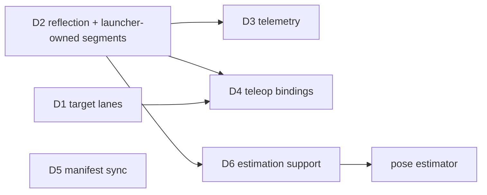

# Design: automatic wiring (no arbiter, no hard-coded subsystems)

Status: partially implemented checkpoint, not acceptance-complete. See
[HANDOFF_AUTOMATIC_WIRING.md](HANDOFF_AUTOMATIC_WIRING.md) for current evidence,
remaining work, and completion order. The rules it serves are in
[METHODOLOGY.md](METHODOLOGY.md). D2, D3, D4, and D6 remain proposals.

## Problem

Robot-wide wiring is code that lists subsystems by name. Adding a subsystem
means either editing that code or squeezing through a generic side door.

| Where | What is hard-coded |
|---|---|
| `2026-robot/main_processor/arbiter/arbiter.h:9-14,88-94,100` | includes and lanes for drivetrain, shooter, intake; everything else via `arbitrate = true` and a hand-mirrored `GenericTarget` |
| `operator_interface/operator_interface.h:11-16,53-58,75` | the same three subsystems; extras via `teleop_button`/`teleop_demand` and a second `GenericTarget` copy |
| `telemetry/node.h:120-129,325-393` | channels for five subsystems by name; extras via `telemetry = true` and a hand-mirrored `GenericState` |
| `main_processor/BUILD:9-27`, `configuration/BUILD:33-46`, `robot.toml` | three copies of the node list |
| `talOS/launcher/launcher.h:781` | the subsystem name `telemetry` |

On top of that, the arbiter is a process every actuator depends on: if it
dies, every target goes stale. It also adds a hop, measured at 3.0 ms median
(p99 5.1 ms) from arbiter to drivetrain.

## Goals

- Adding a subsystem, a producer, or a hardware-less process (pose estimator,
  vision, autonomous) is a node package, its TOML and one `[[subsystems]]`
  line. No other file changes, in any language.
- No node lists other subsystems by name. Every cross-cutting behaviour is
  derived from config plus self-describing topics.
- Each subsystem's safety keeps depending only on its own process and the
  bridge.
- Replay stays deterministic.
- Use existing open-source pieces where they fit (METHODOLOGY §14):
  FlatBuffers reflection for schemas, wpimath for estimation.

Non-goals: changing the hardware path (bridge, gateway, RIO), or Studio's UI
beyond reading descriptors.

---

## D1. Target lanes, resolved inside the consumer (replaces the arbiter)

**Status: substantially implemented; integration and acceptance incomplete.**
`talos::Target`/`TargetLane`/`TargetEnvelope` exist in `talOS/devices/target.h`,
with C ABI version 12, Python wrappers, test helpers, configuration policy,
and graph lane checks. The arbiter is deleted. Mode-transition ordering,
selected-source registry reporting, and current-tree/live verification remain
open; see [the handoff](HANDOFF_AUTOMATIC_WIRING.md).

The pattern is ROS's `twist_mux`: several input lanes, a priority order, a
timeout on each lane, and the highest-priority live lane wins. Here it is
built into the consuming node instead of running as a separate process.

### Topics

Producers write `/<sub>/target/<source>` (`teleop`, `auto`, `align`, ...).
NAMING.md already allows this. The aggregate `/<sub>/target` topic goes away.
Each lane carries a framework envelope around the user struct:

```
struct TargetEnvelope<M> {
  uint64 mode_since_us;   // the producer's Driver Station mode generation; 0: it had none
  uint8  active;
  uint8  padding[7];      // zero
  M      message;         // offset 16
}                         // size = 16 + sizeof(M); alignment = alignof(M)
```

`active = 0` means "this producer has nothing to say". That replaces the
`enabled` field in every target struct, and it replaces the arbiter's
"send stop once on mode change". `mode_since_us` is held as bytes in the C++
struct so the envelope keeps `M`'s alignment (a 4-byte `M` is a 20-byte lane).

### Mode generation

Invariant: a target issued under an earlier Driver Station enable or mode can
never actuate. Receipt time cannot enforce it: every message delivered in one
drain shares the drain's timestamp, so a target queued before a mode change is
indistinguishable, by time, from one derived from the packet that changed the
mode. The generation is therefore carried end to end:

- Every Driver Station sampler (the RoboRIO program, real and WPILib-sim
  alike; `SimHardware`; `send_joystick`) runs one
  `driver_station::ModeTracker`, which stamps `DriverStationData::mode_since_us`
  with the `sample_time_us` of the first sample whose mode key (attached,
  enabled, e-stop, autonomous, teleop, test: `driver_station::ModeKey`)
  differs from the previous sample's; never 0, and strictly later than the
  previous generation. The bridge forwards the packet unchanged.
- A node's generation is its latest packet's `mode_since_us` while its
  Driver Station mode is not none (fresh, attached, enabled, not e-stopped),
  else 0.
- `TargetLane::send` stamps the producer's generation; `release()` sends
  `active = 0`.
- `Target::get` accepts a lane only when its stamp is nonzero and equal to
  the consumer's generation.

A Driver Station link that drops and returns while the RoboRIO stays in the
same mode keeps its generation, so a producer that kept talking drives again as
soon as its lane is fresh; re-enabling or re-attaching starts a new one, and
the old lane stays ignored until the producer resends from the new packet. A
producer and its consumer drain the same packet independently, so for at most
one consumer period after a mode change a lane can be rejected because one of
them has not drained it yet: conservative, never unsafe.

### Policy (TOML, no code)

```toml
# robot.toml: default for every subsystem. DS mode -> lanes, highest priority first.
[robot.targets]
teleop = ["teleop"]
autonomous = ["auto"]
test = []            # pit tests opt in: test = ["test"]

# subsystems/drivetrain.toml: override for one subsystem
[targets]
teleop = ["align", "teleop"]   # auto-align preempts the driver while it is active
```

### Selection, on every drain (deterministic: inputs are the node's own logged messages)

```
mode       = DS mode     (none if the DS is stale, detached, disabled or e-stopped)
generation = latest DS packet's mode_since_us while mode is not none, else 0
selected = first lane L in policy[mode] whose latest envelope
           is younger than command_timeout_us,
           has active = 1, and
           has mode_since_us != 0 and == generation
get()    = robot_enabled(node) && selected ? &selected.message : null
```

- Same generation: an `auto` target from before teleop began, or a teleop
  target from before a disable, can never drive this teleop period, even when
  it arrives in the same drain as the packet that started it.
- `active = 0` falls through to the next lane at once, so releasing an
  auto-align returns control to the driver on the next tick, not after
  100 ms.
- No callback: the node keeps draining just before its timer (no 1 ms
  polling), and selection runs in that drain.

### API (one C++ implementation in `talOS/devices`, wrapped by the C ABI and Python)

```cpp
talos::Target<control::PositionTarget> target_{node};      // lanes /<node>/target/<source> from the policy
if (const control::PositionTarget* t = target_.get()) { motor_.set_motion_magic(t->position_rot()); }
target_.source();                                           // "teleop", "auto", ... or "" when inactive

talos::TargetLane<control::PositionTarget> lane_{node, "wrist", "auto"};  // writes /wrist/target/auto
lane_.send(control::PositionTarget{0.25, 0.0});
lane_.release();                                            // active = 0
```

```python
self.target = talos.Target(node, PositionTarget)
t = self.target.get()                                       # None when inactive
self.lane = talos.TargetLane(node, PositionTarget, "wrist", "auto")
self.lane.send(position_rot=0.25); self.lane.release()
```

C ABI (`node_api.h`, ABI version bump):
- `talos_target_open(node, bytes, align)`
- `talos_target_get(target, out, &source_index)`
- `talos_target_source_name(target, index)`
- `talos_target_lane_open(node, subsystem, source, bytes, align)`
- `talos_target_lane_send(lane, msg)`
- `talos_target_lane_release(lane)`

The selected source is reported in the node's registry row, so Studio shows
who is driving each subsystem.

### Graph lint (`talOS/introspection/names.h`)

| Check | Severity |
|---|---|
| A lane writer whose `<source>` is in no policy for that subsystem (a dead producer) | error |
| A mode's lane with no writer (e.g. nothing writes `/drivetrain/target/auto`) | warning |
| A subsystem writing its own lane | error (existing "target is written by anyone but the owner") |
| Lane sizes, as `envelope(M)` at both ends | error (existing size check; D2 upgrades it to a schema hash) |

### Removed

- the `arbiter` package and `subsystems/arbiter.toml`;
- the arbiter's `GenericTarget`; the operator-interface copy remains until D4;
- the `arbitrate` key;
- `enabled` in target structs;
- the scaffold's arbiter edits.

### Rejected alternatives

- **A generic arbiter node** that the launcher configures from the graph and
  that forwards bytes. It keeps the extra hop and the single point of
  failure, and it puts the mode in one process and the lanes' ordering in
  another (the current code needs subscription-order tricks for this).
- **A lane priority field inside the message.** That makes producers agree on
  numbers. Priority belongs to the consumer's config.

### Acceptance

- `Sim` tests in C++ and Python cover: teleop drives; a mode switch ignores the
  old lane; a target queued before a re-enable is rejected in the same drain
  as the re-enabling packet while one stamped with the new generation is
  accepted; a producer with no mode stamps 0 and never drives; DS loss goes
  neutral and same-mode recovery keeps the generation; re-attach starts a new
  one; a stale high-priority lane falls back to the next; `release()` falls
  through within one tick; `[subsystems.<name>.remap]` redirects one lane.
- The 2026 graph launches without the arbiter, and `--describe-only` is clean.
- Live sim: stick → drive request median drops by the arbiter hop (baseline
  4.98 ms), and the fault table from the LiveSim run still holds.

---

## D2. Self-describing topics (FlatBuffers reflection)

Today a topic is checked by size alone (`names_test.cc:433` says so), and every
generic consumer needs compile-time types. Instead, use FlatBuffers'
own reflection:

- `talos_messages` additionally runs `flatc --binary --schema` to produce
  `<file>.bfbs` (a `reflection.Schema`), and generates
  `talos::Descriptor<M>` (C++: the embedded `.bfbs` bytes plus the root
  struct name) and the same bytes for Python.
  - C++ reads it with `flatbuffers/reflection.h`.
  - Python reads it with classes `flatc` generates from upstream
    `reflection.fbs`. The pip wheel (25.12.19) does not ship them; the
    `@flatbuffers` module source does.
- **Launcher-owned segments.** At startup the launcher creates every declared
  topic segment with its size, slots and descriptor (from `--describe`), and
  unlinks them at session end. Nodes only attach. This also fixes segment
  lifetime (HotPath C8: a creator that exits cleanly unlinks under its peers).
- **Attach checks a schema hash** (the hash of the struct's reflection
  object), not just size. A mismatch fails, naming both types.
- **`.tlog` files carry descriptors** at session start, so `log_dump` can
  decode payloads (an open TODO) and the `.tlog` → MCAP export can emit typed
  channels.
- **The Python codec** (`_messages.py`) reads layout from reflection instead of
  recording `Create<Struct>` calls. The recorder heuristic is deleted.
- **Field-name lint** against the METHODOLOGY §6 suffix table runs in the
  `talos_messages` action and fails the build.

**Acceptance:**
- `log_dump` prints decoded fields for every topic.
- A deliberately changed field type with the same size is rejected at attach.
- The Python codec tests pass on reflection alone.

---

## D3. Telemetry from descriptors (framework node)

`//talOS/telemetry:node` replaces the robot's telemetry node. It holds no
subsystem names.

- **Sources.** Every `state` and `status` topic in the declared graph (the
  launcher hands the graph to it). It is an *observer*: it attaches read-only
  and the lint does not count it as a consumer. Adjust with
  `[telemetry] include` / `exclude` globs.
- **Channels.** `<owner>/<role>/<field>`, e.g. `shooter/state/velocity_rps`.
  Nested structs flatten with `/`.
  - The unit comes from the suffix, so the hand-written `"rev/s"` strings
    disappear.
  - Enum labels come from the reflection enum.
  - Bools encode as 0/1.
  - Stale or absent becomes NaN, as today.
- **Frame pose.** `[studio] pose_topic` names the topic whose
  `geometry.Pose2d` field fills the Frame's chassis pose.
- **Budget.** The existing construction-time frame-size check stays. It now
  fails with the list of the largest sources.
- **Launcher.** It finds the watched topic via `[studio] topic` instead of
  `kStudioBridgeName` and the hard-coded `telemetry` name.

**Removed:** `GenericState`, the `telemetry`/`telemetry_unit` keys, and the
robot's telemetry package.

**Acceptance:** a scaffolded subsystem appears in Studio with correct units and
no edits outside its own package.

---

## D4. Declarative teleop bindings (framework node)

`//talOS/teleop:node` reads each subsystem's `[teleop]` table and writes that
subsystem's `teleop` lane. It encodes by field name through the lane's
descriptor.

```toml
# subsystems/wrist.toml
[[teleop.bindings]]
button = 3                     # joystick 0 unless port = N; 1-based like the DS
while_held = { position_rot = 0.25 }

[[teleop.bindings]]
axis = 1
field = "velocity_rps"
scale = 60.0                   # in the field's unit
deadband_frac = 0.05
```

Semantics:
- While a binding is live, it sends `active = 1` with the given fields; the
  other fields are zero.
- With no live binding, it calls `release()`.
- It sends nothing while the DS is disabled, not in teleop, or the stick is
  disconnected.

Chassis driving (deadband, field-oriented rotation, pose) stays robot code: a
small `driver` node writing `/drivetrain/target/teleop`. It is the current
`operator_interface` without its mechanism bindings.

**Removed:** `teleop_button`/`teleop_demand`, the remaining `GenericTarget`, and
the mechanism code in `operator_interface`.

**Acceptance:** a Python wrist gets a button by TOML alone, and the live sim shows
its lane active.

---

## D5. The manifest is the single source (implemented; hardening and integration verification incomplete)

- `robot.toml` `[[subsystems]]` is the only node list.
- `bazel run //tools:sync_manifest -- <dir>/robot.toml` writes
  `<dir>/robot_manifest.bzl` beside the config (`<stem>_manifest.bzl` for
  other names, e.g. `robot_py_manifest.bzl`): `NODES`, the node labels, and
  `CONFIG_FILES`, every file the config reads besides itself (`include`,
  `path`, `defaults`). It is a short Python `tomllib` script
  (`tools/sync_manifest.py`), the only reader besides the C++ parser, and
  follows the parser's `include`/`node`/`defaults` precedence.
- `talos_bundle` (`nodes`, `config_files`) and `talos_graph_test` (`nodes`,
  `data`) take `NODES` and `CONFIG_FILES`.
- `manifest_sync_test` (`tools/sync_manifest.bzl`) runs the script with
  `--check` and fails, with the regenerate command and a diff, when the
  manifest is stale. It sees only the files `CONFIG_FILES` lists, so an entry
  naming a new file fails too.
- `new_subsystem` edits `robot.toml`, writes the subsystem file and
  regenerates the manifest. It edits no BUILD file.
- Bundling stages every config file at its path relative to the config, so
  `defaults = "..."` files and non-default `path`s resolve in the bundle.

**Acceptance:** adding a `[[subsystems]]` line without running the sync fails
CI with the fix printed.

---

## D6. Estimation support, and adding a pose estimator

What a pose estimator needs, and what is missing today:

| Need | Today | Change |
|---|---|---|
| Wheel module positions (distance, angle) | `DrivetrainState` has chassis speeds only | add `modules: [geometry.SwerveModulePosition x4]` (`distance_m`, `angle_rad`) |
| Gyro heading with validity | `yaw_rot`, which reads 0 when disconnected | `yaw_rad` + `yaw_valid` |
| When a sample was taken | `timestamp_ns` = publish time | `sample_time_ns`: `HardwareLink::sample_time()` maps the gateway's `sample_time_us` into the node clock (the bridge keeps a min-filtered offset). Exposed in C++, C ABI and Python. |
| Vision observations | none | `geometry.PoseObservation { sample_time_ns, pose: Pose2d, std_x_m, std_y_m, std_yaw_rad, tag_count, valid }` in `talOS/msgs` |
| Estimator math | hand-written odometry | wpimath `SwerveDrive4PoseEstimator` (C++ from allwpilib's Bazel build; Python `robotpy-wpimath`). The Bazel route on macOS arm64 is unverified. |
| Offline tuning | `--replay` replays a node's own log | `--replay-inputs <session>`: drive a *new* node from another session's logged topics |
| A list parameter (`cameras = [...]`) | `param<T>` takes bool, integer, double or string only (`talOS/node/node.h:274`) | `param<std::vector<std::string>>` and `std::vector<double>`, in the C ABI and Python |

With D1–D6 in place, **adding a pose estimator** takes these steps:

1. `bazel run //tools:new_subsystem -- pose_estimator --lang py --type estimator`
   generates a node with no devices, a `geometry.PoseEstimate` state and a
   `Sim` test skeleton.
2. Write the node (≈ 40 lines):

   ```python
   from wpimath.estimator import SwerveDrive4PoseEstimator
   class PoseEstimator:
       def __init__(self, node):
           self.drive = node.subscribe(DrivetrainState, "/drivetrain/state")
           self.cameras = [node.subscribe(PoseObservation, f"/{c}/state")
                           for c in node.param("cameras")]    # list in TOML
           self.est = SwerveDrive4PoseEstimator(kinematics_from(node), ...)
           self.state = node.publish(PoseEstimate, "state")
       def update(self):
           d = self.drive.value
           if self.drive.fresh() and d.yaw_valid:
               self.est.updateWithTime(d.sample_time_ns * 1e-9, Rotation2d(d.yaw_rad), modules(d))
           for cam in self.cameras:
               o = cam.value
               if cam.updated and o.valid:
                   self.est.addVisionMeasurement(pose(o), o.sample_time_ns * 1e-9, stds(o))
           self.state.send(...)   # every tick, valid flag from drive freshness
   ```
3. Add a `subsystems/pose_estimator.toml` with `cameras = ["front_camera"]`, and
   one `[[subsystems]]` line.
4. Point consumers at it with config only: `[studio] pose_topic`, and
   `pose_topic = "/pose_estimator/state"` on the `driver` node (or `remap`).
5. Tune offline: `--replay-inputs` against a match session. It shows up in
   Studio with units, without further work.

The camera side is another node:
- a `photon` node reads PhotonVision results (photonlib) and publishes
  `/front_camera/state`;
- or an in-process AprilTag pipeline (`robotpy-apriltag`) does the same.

---

## 7. Order and verification



| Step | Lands | Verify (all with `bazel build //...`, `bazel test //...`) |
|---|---|---|
| 1 | D5: small and independent | `manifest_sync_test`; `bundle_test` |
| 2 | D1, migrating the 2026 robot and the scaffold; delete the arbiter | D1 acceptance; `--describe-only` on every config; live sim fault table |
| 3 | D2 | D2 acceptance |
| 4 | D3, then D4; delete the robot telemetry package and `GenericTarget`/`GenericState` | D3/D4 acceptance; Studio shows a scaffolded subsystem |
| 5 | D6 (wpimath dependency first, verified on macOS arm64 and Linux) | estimator `Sim` test; `--replay-inputs` on a recorded sim session |

Every step updates `ARCHITECTURE.md`, `NODE_DEVELOPMENT_GUIDE.md`,
`examples/superstructure`, `tools/new_subsystem.py` and the "planned" marks in
METHODOLOGY.md in the same change.

## 8. Decisions taken here (flip before step 2 if you disagree)

| Decision | Chosen | Alternative |
|---|---|---|
| Where arbitration runs | inside each consumer (D1) | a generic arbiter node (rejected above) |
| Angle units | `_rad` in the field and chassis frame, `_rot` for shafts and joints | `_rot` everywhere: matches Phoenix, but every trig call converts and wpimath's `Rotation2d` is radians |
| Target "stop" | framework envelope `active` flag | keep `enabled` in each struct |
| Manifest → Bazel | generated `manifest.bzl` plus a sync test | a module extension parsing TOML in Starlark |
